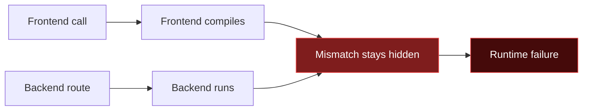
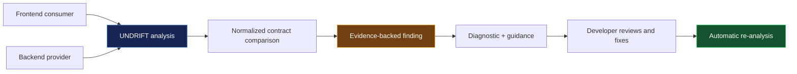
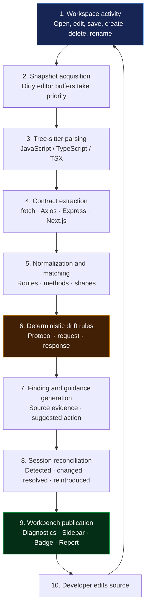
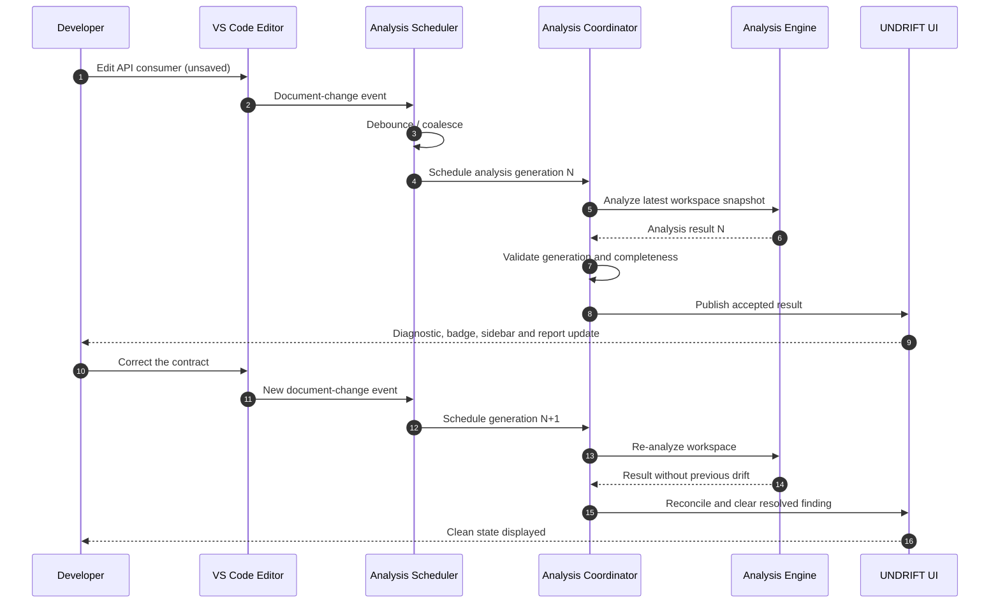
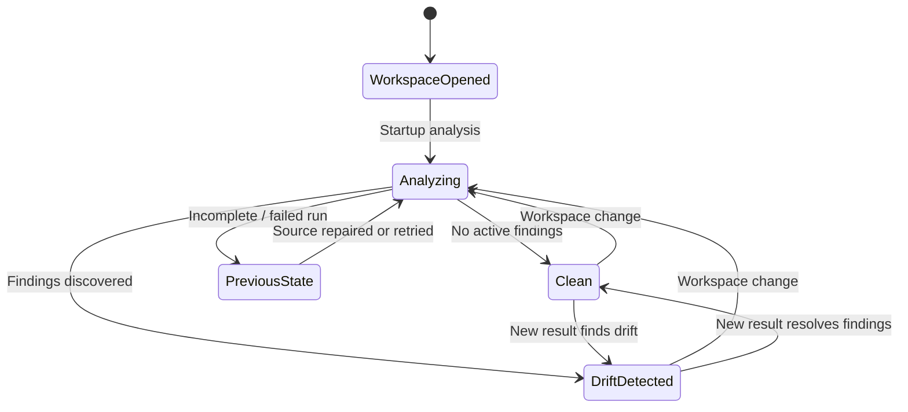
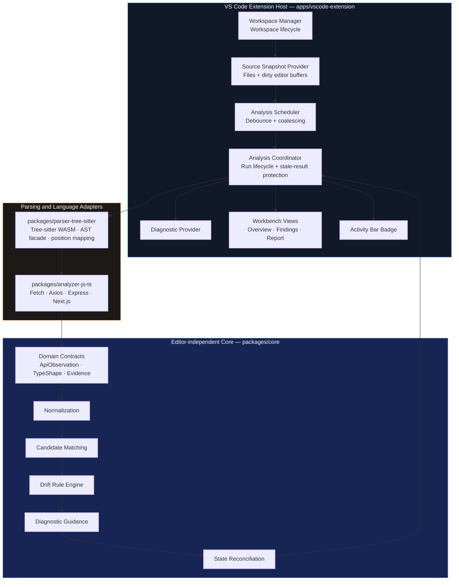
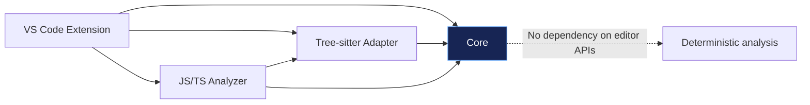
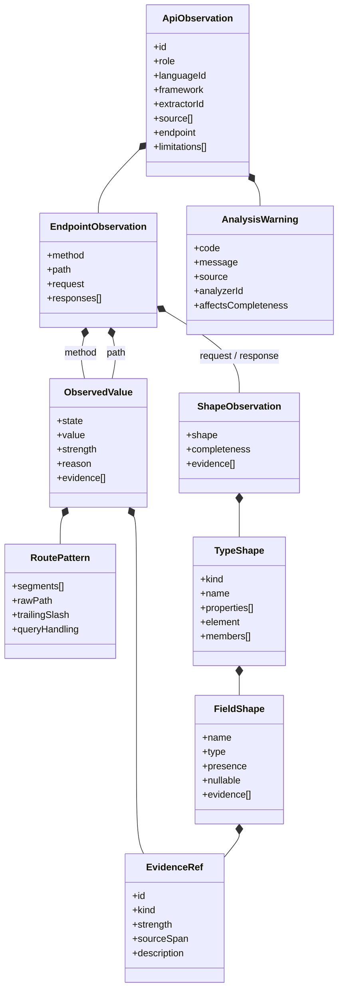
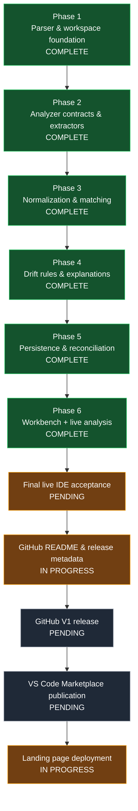

<div align="center">

# UNDRIFT

### Live frontend–backend API contract intelligence inside your developer workspace.

**Detect contract drift. Understand the evidence. Fix it where you code.**

<p>
  <a href="https://github.com/parnilV06/undrift">
    
  </a>
  <a href="https://www.typescriptlang.org/">
    
  </a>
  <a href="https://tree-sitter.github.io/tree-sitter/">
    
  </a>
  <a href="https://code.visualstudio.com/api">
    
  </a>
  <a href="LICENSE">
    
  </a>
</p>

<p>
  
  
  
  
</p>

<p>
  <a href="#what-is-undrift">Overview</a> ·
  <a href="#how-it-works">How it works</a> ·
  <a href="#capabilities-and-project-status">Capabilities</a> ·
  <a href="#getting-started">Get started</a> ·
  <a href="#roadmap-and-release-status">Roadmap</a>
</p>

</div>

---

> [!IMPORTANT]
> **Current project status — November 2026:** UNDRIFT V1 implementation is feature-complete across Phases 1–6. Automated regression checks and isolated synthetic-fixture component-integration acceptance scenarios have passed. The project is in final release preparation. The VS Code Marketplace release and landing-page deployment have **not** happened yet. A final manual acceptance pass through the live Extension Development Host remains a separate validation step.

## Table of Contents

<details open>
<summary><strong>Open navigation</strong></summary>

- [What Is UNDRIFT?](#what-is-undrift)
- [The Problem](#the-problem)
- [How It Works](#how-it-works)
- [What UNDRIFT Detects](#what-undrift-detects)
- [Capabilities and Project Status](#capabilities-and-project-status)
- [Supported Extraction Patterns](#supported-extraction-patterns)
- [Workbench Experience](#workbench-experience)
- [Architecture Overview](#architecture-overview)
- [Analysis Model and Evidence](#analysis-model-and-evidence)
- [Technology Stack](#technology-stack)
- [Repository Structure](#repository-structure)
- [Getting Started](#getting-started)
- [Configuration](#configuration)
- [Validation and Quality](#validation-and-quality)
- [Design Principles](#design-principles)
- [Current Limitations](#current-limitations)
- [Roadmap and Release Status](#roadmap-and-release-status)
- [Documentation](#documentation)
- [Contributing](#contributing)
- [License and Links](#license-and-links)

</details>

---

## What Is UNDRIFT?

UNDRIFT is a **local-first, IDE-native API contract analysis tool** that detects mismatches between frontend API consumers and backend route providers.

It statically analyzes a JavaScript/TypeScript workspace, extracts API contracts from recognizable source patterns, correlates the consumer and provider sides, and reports discrepancies with source-linked evidence. Findings are surfaced directly in the editor through diagnostics, a dedicated sidebar, an Activity Bar badge, and an integration report.

The defining idea is simple:

**An API integration can be broken even when both sides are valid on their own.**

A frontend call can compile. A backend route can run. Yet the two can disagree about the URL, HTTP method, request body, or response shape. Those disagreements often remain invisible until a user hits the affected flow at runtime.

UNDRIFT brings that integration boundary into the developer workspace.

### At a glance

| | |
|---|---|
| **Product** | IDE-first frontend–backend API contract intelligence |
| **V1 editor target** | Visual Studio Code |
| **Analysis approach** | Static source analysis; no application execution |
| **Parser** | Web-Tree-sitter with WebAssembly grammars |
| **V1 language scope** | JavaScript and TypeScript, including JSX/TSX |
| **Consumer patterns** | Standard `fetch()` and Axios method calls |
| **Provider patterns** | Express route declarations and supported Next.js route-handler patterns |
| **Core architecture** | Editor-independent analysis core with a VS Code host adapter |
| **Privacy model** | Local-first; source code is analyzed on the developer's machine |
| **Current milestone** | V1 feature-complete; release preparation in progress |

---

## The Problem

A typical full-stack feature crosses an API boundary:

- The frontend assumes a method, route, request payload, and response structure.
- The backend implements a route, validates a request, and returns a response.
- Neither side necessarily has a direct compile-time relationship with the other.

Consider a frontend consumer:

```ts
// Frontend: the UI expects a camelCase property.
type UserProfile = {
  id: string;
  userName: string;
};

export async function getUser(userId: string): Promise<UserProfile> {
  const response = await fetch(`/api/users/${userId}`);
  return response.json();
}
```

And a backend provider:

```ts
// Backend: the route returns a snake_case property.
app.get("/api/users/:id", (req, res) => {
  res.json({
    id: req.params.id,
    user_name: "Ada Lovelace",
    status: "active",
  });
});
```

Both files can be syntactically valid. The frontend type annotation does not prove that the server actually returns `userName`.

### Without UNDRIFT



The mismatch can surface as an `undefined` UI value, an HTTP 404/405, a rejected request, or a broken user journey. Developers then have to trace the client call and server implementation manually.

### With UNDRIFT



UNDRIFT does not need to execute the application to identify statically discoverable integration disagreements. It reasons from source patterns and preserves uncertainty wherever the source does not provide enough evidence.

---

## How It Works

UNDRIFT follows a deterministic analysis pipeline. The extension watches the workspace, obtains the latest source snapshots, and passes them through the editor-independent analysis packages. Accepted results are then reconciled and published to the VS Code workbench.



### The continuous-analysis loop

The V1 workflow is designed around normal development activity—not a manual scan after every change.

1. **Open a workspace.** UNDRIFT can run its initial analysis automatically.
2. **Work normally.** The extension observes relevant editor and workspace file events.
3. **Change a contract.** A dirty editor buffer can be analyzed before the file is saved.
4. **See the drift.** Findings flow into diagnostics and the UNDRIFT workbench surfaces.
5. **Resolve the mismatch.** The developer edits the consumer or provider.
6. **See the result update.** A new analysis reconciles the latest state and clears resolved findings.

### Scheduling and stale-result safety

Continuous analysis uses a configurable debounce interval and coalesces bursts of changes. When a newer analysis supersedes an in-flight run, an older result must not overwrite the newer workspace state.



> [!NOTE]
> The scheduler coalesces workspace events; it does not imply that every keystroke causes a separate full scan. Dirty editor buffers are preferred over stale disk contents. Superseded results are rejected before publication.

---

## What UNDRIFT Detects

UNDRIFT builds relationships between API consumers and providers, then evaluates the evidence available for each relationship.

| Contract dimension | Example disagreement | What UNDRIFT can report |
|---|---|---|
| **Route** | Consumer calls `/api/users` while provider exposes a different route | Suspected or unmatched route relationship, subject to coverage |
| **HTTP method** | Consumer sends `POST`, provider exposes `GET` | Method conflict |
| **Request shape** | Consumer omits a provider-required field or sends an incompatible shape | Request contract mismatch where sufficient shape evidence exists |
| **Response shape** | Provider returns a field or structure that does not satisfy the consumer expectation | Response contract mismatch where sufficient shape evidence exists |
| **Provider coverage** | A provider has no known consumer | Informational coverage finding; not proof that the endpoint is dead |
| **Analysis coverage** | Dynamic or unsupported code prevents a reliable conclusion | Explicit warning or partial-coverage explanation |

### Findings are evidence-aware

UNDRIFT distinguishes a confirmed mismatch from a lack of static evidence.

- **Known values** are extracted directly or resolved from supported static declarations.
- **Inferred values** are retained with their evidence classification.
- **Unknown or dynamic values** remain uncertain instead of being guessed.
- **Incomplete scans** are treated conservatively; missing evidence is not automatically interpreted as proof of missing functionality.

For example, `UND110` indicates that a provider has no known consumer in the analyzed scope. It is informational and should not be read as a confirmed dead-endpoint diagnosis. `UND120` identifies an HTTP method conflict.

---

## Capabilities and Project Status

The table below reflects the V1 implementation state represented by the current project milestone and validation report.

| Capability | Status | Current behavior |
|---|---|---|
| Workspace source discovery | **Implemented** | Discovers supported JavaScript/TypeScript source files, applies exclusions, and creates deterministic snapshots. |
| Dirty editor buffer support | **Implemented** | Uses unsaved editor contents in preference to the on-disk version. |
| Tree-sitter WASM parsing | **Implemented** | Parses JavaScript, TypeScript, JSX, and TSX through WebAssembly grammars. |
| API observation contracts | **Implemented** | Produces language-neutral consumer/provider observations with source evidence and coverage metadata. |
| Fetch extraction | **Implemented** | Recognizes supported standard `fetch()` calls, methods, routes, and statically discoverable request payloads. |
| Axios extraction | **Implemented** | Recognizes supported Axios method calls and statically discoverable request information. |
| Express provider extraction | **Implemented** | Extracts supported `app.<method>()` and `router.<method>()` route declarations and response information. |
| Next.js route extraction | **Implemented — bounded patterns** | Supports the implemented App Router and bounded Pages Router patterns, including dynamic route normalization. |
| Cross-file and real-world scan hardening | **Implemented — bounded** | Includes supported route composition, helper argument, payload dataflow, and attribution improvements; unresolved cases remain explicit. |
| Route and shape normalization | **Implemented** | Canonicalizes supported route and structural shape representations. |
| Consumer/provider matching | **Implemented** | Builds candidate relationships using conservative route and method matching. |
| Deterministic drift rules | **Implemented** | Evaluates supported protocol, route, request, and response compatibility rules. |
| Evidence-backed diagnostics | **Implemented** | Associates findings with source locations and rule-specific explanations. |
| Resolution guidance | **Implemented** | Provides rule- and warning-specific guidance in diagnostic hover and the Integration Report. |
| Quick Fix proposals | **Implemented** | Exposes supported, reviewable editor actions; fixes are not silently applied. |
| Session persistence | **Implemented** | Persists workspace analysis state and finding lifecycle information using VS Code-managed storage. |
| Workbench UI and brand integration | **Implemented** | Includes the UNDRIFT Activity Bar entry, sidebar overview, findings view, theme-aware report, and official brand identity. |
| Continuous workspace analysis | **Implemented** | Runs startup analysis and schedules re-analysis on relevant document and filesystem changes. |
| Live drift resolution | **Implemented** | Reconciles findings when a mismatch is corrected, reverted, or discarded. |
| AI-based automatic resolution | **Not in V1** | A future AI Resolution Layer is outside the current V1 implementation scope. |
| VS Code Marketplace publication | **Pending** | Release packaging and publication are part of the remaining release workflow. |
| Public landing page | **In progress** | Landing-page work is underway; deployment is a separate release activity. |

### Phase 6 implementation breakdown

Phase 6 was delivered through focused implementation chunks:

| Chunk | Focus | Result |
|---|---|---|
| **6.1** | Workbench integration foundation | Extension-side analysis and workbench integration groundwork |
| **6.2** | Real-world stack scanning hardening | Improved route resolution, composed API URLs, and Next.js scan reliability |
| **6.3** | Analysis coverage improvements | Dynamic/nested route handling, static payload inference, helper arguments, FormData attribution, and supported cross-module payload dataflow |
| **6.4** | Diagnostic guidance and resolution UX | Rule-specific guidance, compact hovers, clearer Integration Report recommendations, and warning explanations |
| **6.5** | Workbench UI refresh and brand integration | Theme-aware workbench presentation and official UNDRIFT logo integration |
| **6.6** | Continuous workspace analysis | Startup scanning, debounced background analysis, dirty-buffer monitoring, event coalescing, and live finding resolution |

---

## Supported Extraction Patterns

UNDRIFT's V1 extraction scope is intentionally bounded. The analyzer recognizes supported source patterns instead of attempting to execute application code or infer arbitrary runtime behavior.

### Consumer patterns

| Consumer | Recognized pattern | Extracted information |
|---|---|---|
| Standard Fetch | `fetch("/api/tasks")` | Route and default `GET` method |
| Fetch with options | `fetch(url, { method, body })` | Static method and supported request payload details |
| Axios methods | `axios.get/post/put/patch/delete(...)` | Method, route, and supported request-body information |
| Static constants | `const API = "/api/tasks"; fetch(API)` | Same-document static value resolution |
| Supported helper patterns | Statically traceable helper arguments and payload flows | Resolved route or payload details where the implemented analysis can establish provenance |

### Provider patterns

| Provider | Recognized pattern | Extracted information |
|---|---|---|
| Express app routes | `app.get("/api/tasks", handler)` | HTTP method and route |
| Express router routes | `router.post("/api/tasks", handler)` | HTTP method and route |
| Express responses | `res.json(...)`, `res.status(...).json(...)` | Supported status and response-shape information |
| Next.js App Router | Supported `app/**/route.ts` route-handler patterns | Route and exported HTTP-method handler information |
| Next.js Pages Router | Bounded supported API route patterns | API route and statically discoverable handler information |

### Analysis hardening included in V1

The implementation evolved beyond isolated one-file extraction. The current analyzer includes bounded handling for:

- Mounted Express routes and composed API URL patterns.
- Next.js dynamic and nested dynamic route normalization.
- Static request payload inference from supported expressions.
- Statically traceable API helper route arguments.
- Supported cross-module payload dataflow.
- More accurate `FormData` construction and attribution.
- Evidence-backed coverage diagnostics when analysis cannot confidently resolve a pattern.

### Important extraction boundary

A recognized syntax pattern is not the same as arbitrary semantic execution. Dynamic method dispatch, runtime-built URLs, complex wrapper chains, reflection, and unsupported module flows may remain unknown or partially understood. UNDRIFT reports these limitations rather than manufacturing a contract.

---

## Workbench Experience

UNDRIFT is designed to keep findings close to the source code and make the current analysis state visible without requiring developers to leave their workspace.

| Workbench surface | Purpose |
|---|---|
| **Activity Bar** | Dedicated UNDRIFT entry point and active-finding badge |
| **Sidebar Overview** | High-level analysis state and finding summary |
| **Findings Tree** | Navigable list of detected integration findings |
| **Editor Diagnostics** | Source-linked diagnostics on relevant code |
| **Diagnostic Hover** | Compact explanation and recommended next action |
| **Quick Fix / Code Actions** | Reviewable fixes for supported mechanical cases |
| **Integration Report** | Theme-aware workspace report with findings, coverage context, and resolution guidance |

### The live feedback loop



The last accepted analysis state is protected during incomplete or superseded runs. The UI is updated from accepted analysis state rather than allowing an obsolete run to publish stale findings.

---

## Architecture Overview

UNDRIFT is organized as an npm workspaces monorepo. The analysis core remains independent of VS Code APIs, while the editor host adapts workspace events and presents analysis results.



### Package responsibilities

| Package / application | Responsibility | Architectural boundary |
|---|---|---|
| `apps/vscode-extension` | Activation, workspace events, scheduling, diagnostics, views, report, and editor commands | Owns VS Code integration; adapts editor APIs to the core |
| `packages/core` | Language-neutral observations, route/shape normalization, matching, drift rules, guidance contracts, and state reconciliation | Must not depend on VS Code or Tree-sitter |
| `packages/parser-tree-sitter` | Tree-sitter WASM runtime, grammar loading, syntax facade, and source-position mapping | Converts source text into syntax structures; has no API-contract policy |
| `packages/analyzer-js-ts` | JavaScript/TypeScript consumer and provider extractors, indexes, resolvers, and analysis registry | Converts syntax into domain observations; does not own workbench presentation |

### Architectural dependency direction



The core can be tested and reasoned about independently of the editor host. This separation is deliberate: future editor integrations should adapt the host layer rather than introduce VS Code dependencies into the analysis engine.

---

## Analysis Model and Evidence

The analysis engine works with normalized, language-neutral observations. It does not make drift decisions directly from raw Tree-sitter nodes.

### Conceptual model



### Evidence and uncertainty

Every extracted fact should carry enough context for the analysis engine to decide how strongly it can be used.

| Evidence concept | Meaning |
|---|---|
| `direct` | Directly present in a recognized source construct |
| `resolved` | Obtained by resolving a supported static declaration or reference |
| `inferred` | Derived through a supported inference with traceable provenance |
| `unknown` | The available source does not justify a reliable value |

UNDRIFT uses explicit knowledge states rather than pretending every expression can be statically evaluated.

```ts
// Direct evidence: a literal route.
fetch("/api/tasks");

// Resolved evidence: a same-document static constant.
const TASKS_API = "/api/tasks";
fetch(TASKS_API);

// Unknown or dynamic: runtime construction cannot be assumed.
const endpoint = getEndpointFromRuntimeConfig();
fetch(endpoint);
```

### Coverage is part of the result

Analysis coverage is not just a progress indicator. It affects whether the engine can responsibly conclude that a consumer or provider is absent. If a scan is incomplete or a relevant pattern is unsupported, UNDRIFT preserves that limitation so that absence is not misreported as confirmed drift.

---

## Technology Stack

| Category | Technology | Purpose |
|---|---|---|
| Language | TypeScript | Primary implementation language across the monorepo |
| Runtime | Node.js | Package builds, tests, and extension development |
| Monorepo | npm Workspaces | Package management and local workspace linking |
| Parser | `web-tree-sitter` | WebAssembly-based Tree-sitter parsing |
| Grammars | Tree-sitter JavaScript / TypeScript / TSX WASM grammars | Parsing supported source files |
| Extension API | VS Code API | Workspace lifecycle, editor events, diagnostics, commands, and views |
| Bundler | esbuild | Extension bundling and WASM asset packaging |
| Testing | Vitest | Unit and component-integration tests |
| Type checking | TypeScript compiler | Static type validation |
| Linting | ESLint | Code-quality enforcement |
| Formatting | Prettier | Consistent source formatting |

> Exact dependency versions are defined by the workspace manifests and lockfile. The package manifests are the source of truth for version constraints.

---

## Repository Structure

The repository separates the VS Code host, analysis packages, specifications, regression fixtures, and tests.

```text
undrift/
├── apps/
│   └── vscode-extension/
│       ├── src/
│       │   ├── activation/          # Extension activation and lifecycle
│       │   ├── commands/            # User-invokable commands
│       │   ├── diagnostics/         # VS Code diagnostics and code actions
│       │   ├── fixes/               # Reviewable workspace edit support
│       │   ├── logging/             # Extension logging
│       │   ├── views/               # Overview, findings, report, and UI providers
│       │   ├── workspace/           # Workspace manager and source snapshots
│       │   └── extension.ts         # Extension entry point
│       ├── package.json             # Extension manifest
│       └── esbuild.config.mjs       # Extension bundling and WASM assets
│
├── packages/
│   ├── core/
│   │   ├── src/
│   │   │   ├── domain/              # Observations, findings, evidence, shapes
│   │   │   ├── matching/            # Consumer/provider candidate matching
│   │   │   ├── normalization/       # Route and type-shape normalization
│   │   │   ├── rules/               # Deterministic drift rules
│   │   │   ├── explanations/        # Rule-aware explanation and guidance
│   │   │   ├── fixes/               # Fix proposal contracts and generation
│   │   │   ├── reporting/           # Report and analysis result models
│   │   │   └── index.ts
│   │   └── package.json
│   │
│   ├── parser-tree-sitter/
│   │   ├── src/
│   │   │   ├── grammar-registry/    # WASM grammar discovery and loading
│   │   │   ├── runtime/             # Parser runtime lifecycle
│   │   │   ├── syntax-view/         # Language-neutral syntax facade
│   │   │   ├── position-mapping.ts  # UTF-16 and byte-offset mapping
│   │   │   └── index.ts
│   │   └── package.json
│   │
│   └── analyzer-js-ts/
│       ├── src/
│       │   ├── frontend/            # Fetch and Axios extractors
│       │   ├── backend/             # Express and Next.js provider extractors
│       │   ├── project-index/       # Supported declaration and reference indexing
│       │   ├── registry/            # Analyzer registration and dispatch
│       │   ├── shapes/              # Request and response shape extraction
│       │   ├── support-matrix.ts    # Supported-pattern catalog
│       │   └── index.ts
│       └── package.json
│
├── docs/
│   ├── PRD.md                      # Product Requirements Document
│   ├── TRD.md                      # Technical Requirements Document
│   ├── ERD.md                      # Entity Relationship / logical data model
│   ├── HLD.md                      # High-Level Design
│   ├── LLD.md                      # Low-Level Design
│   └── DEVELOPMENT.md              # Development and debugging guide
│
├── examples/
│   ├── Cubit/
│   ├── Expense Tracker/
│   ├── Fullstack Creators/
│   └── SlotTrack/
│
├── tests/                          # Core, analyzer, integration, and regression tests
├── package.json                    # Root scripts and npm workspace configuration
├── package-lock.json
├── tsconfig.base.json
├── vitest.config.ts
└── eslint.config.mjs
```

The landing page is being developed as a separate workstream. Its final repository location and deployment configuration should be documented here once that integration is settled; it is not represented as a released part of the VS Code extension.

---

## Getting Started

### Prerequisites

- **Node.js:** `>= 18.0.0` (use the version supported by the current workspace toolchain).
- **npm:** `>= 9.0.0`.
- **VS Code:** a version satisfying the extension manifest's `engines.vscode` requirement.

### Clone and install

```bash
git clone https://github.com/parnilV06/undrift.git
cd undrift
npm install
```

### Validate the repository

```bash
# Run the full monorepo test suite
npm test

# Type-check all workspaces
npm run typecheck

# Run lint checks
npm run lint

# Check formatting
npm run format:check

# Build packages and the VS Code extension
npm run build
```

### Launch the Extension Development Host

1. Open the repository in VS Code.
2. Install dependencies and build the monorepo.
3. Open **Run and Debug**.
4. Select the extension launch configuration.
5. Press `F5` to launch the Extension Development Host.
6. Open a JavaScript/TypeScript application workspace in the new window.
7. Open the Command Palette and run **UNDRIFT: Scan Workspace** if you want to invoke a manual scan.

With automatic analysis enabled, opening the workspace also triggers the configured startup analysis. The manual command remains available.

> [!TIP]
> To validate live behavior without modifying a real application, use a disposable synthetic React + Express fixture. Keep acceptance fixtures outside the UNDRIFT repository and do not use production or personal project folders as test sandboxes.

---

## Configuration

UNDRIFT exposes analysis behavior through VS Code settings under the `undrift.analysis` namespace.

| Setting | Type | Default | Description |
|---|---|---:|---|
| `undrift.analysis.autoRun` | `boolean` | `true` | Enables or disables automatic background analysis after relevant workspace changes. |
| `undrift.analysis.debounceMs` | `number` | `800` | Debounce delay, in milliseconds, before scheduled analysis runs. Supported range: `100`–`5000`. |
| `undrift.analysis.runOnStartup` | `boolean` | `true` | Runs an initial workspace analysis when a workspace is opened. |

Example `settings.json`:

```json
{
  "undrift.analysis.autoRun": true,
  "undrift.analysis.debounceMs": 800,
  "undrift.analysis.runOnStartup": true
}
```

Settings are read by the extension configuration layer. Consult the extension manifest and current configuration implementation for the authoritative behavior of a particular build.

### Workspace exclusions

The source snapshot layer excludes common generated or dependency directories, including:

- `node_modules`
- `.git`
- `dist`, `build`, and `out`
- `coverage`
- `.next`, `.nuxt`, and common framework caches
- Minified JavaScript files

The implementation's default exclusion list is the source of truth. Workspace discovery is designed to avoid scanning generated output and dependency trees as application source.

---

## Validation and Quality

UNDRIFT has completed its V1 automated regression and component-integration validation cycle.

### Latest reported automated quality checks

<p>
  
  
  
  
  
</p>

| Check | Latest reported result |
|---|---|
| Monorepo tests | **1,058 passing tests across 58 test files** |
| TypeScript typecheck | **Passed — zero errors** |
| ESLint | **Passed — zero errors and warnings** |
| Extension/package build | **Passed** |
| Working tree after acceptance verification | **Clean** |
| Sample project protection check | **No changes reported under `examples/`** |

### Continuous-analysis acceptance coverage

A separate acceptance exercise used isolated synthetic workspaces outside the repository. The scenarios were exercised through the component-integration harness, with the Extension Development Host launch also attempted for host-level checks.

| Acceptance scenario | Result reported |
|---|---|
| Automatic startup analysis | **PASS** |
| Unsaved frontend edit creates a method conflict | **PASS** |
| Unsaved correction clears the finding | **PASS** |
| Discarding an unsaved change returns to disk content | **PASS** |
| Backend route change and restoration | **PASS** |
| File create, delete, and rename lifecycle | **PASS** |
| Burst edit coalescing | **PASS** |
| Superseded in-flight result rejection | **PASS** |
| Diagnostic, badge, sidebar, and report data synchronization in the integration harness | **PASS** |
| Workspace switching isolation | **PASS** |
| Settings behavior and manual scan override | **PASS** |
| External filesystem change detection | **PASS** |
| Incomplete analysis and recovery | **PASS** |

> [!WARNING]
> These results establish automated and component-integration behavior. They should not be interpreted as proof that every scenario has been manually demonstrated through the live VS Code/Antigravity Extension Development Host UI. A final hands-on IDE acceptance pass remains a release validation item.

### Synthetic fixture performance observations

The acceptance report recorded the following single-run measurements on synthetic JavaScript/TypeScript workspaces:

| Supported source files | Observations (consumer / provider) | Reported full-scan duration | Reported edit duration |
|---:|---:|---:|---:|
| 4 | 1 / 1 | 38 ms | 18 ms |
| 10 | 5 / 5 | 4 ms | 2 ms |
| 50 | 25 / 25 | 9 ms | 5 ms |
| 100 | 50 / 50 | 18 ms | 9 ms |

These are **observations from the acceptance run, not formal benchmark guarantees**. Runtime warm-up, fixture shape, environment, and measurement method can affect results. Repeated controlled benchmarks are required before making comparative performance claims.

---

## Design Principles

1. **Local-first by default.** Static source parsing and contract analysis run on the developer's machine. Standard contract discovery does not require a hosted service or LLM API key.
2. **Editor-independent core.** The core analysis model and rule engine do not depend on VS Code or Tree-sitter implementation details.
3. **Parser/analyzer separation.** Tree-sitter supplies syntax structure; framework-specific analyzers interpret supported API patterns.
4. **Evidence travels with facts.** Extracted values retain source spans and evidence provenance so findings can be traced back to code.
5. **Unknown is not false.** Dynamic or unsupported expressions remain uncertain. Lack of evidence is not treated as proof of a mismatch.
6. **Conservative matching.** Candidate relationships and absence findings are gated by analysis coverage to reduce false positives.
7. **Reviewable changes.** Quick Fix proposals remain visible to the developer; UNDRIFT does not silently rewrite application code.
8. **Workspace hygiene.** Analysis state belongs in VS Code-managed storage rather than creating repository files in the user's application.
9. **No application execution for static discovery.** Analyzers do not need to run user scripts or start application servers to extract supported contracts.
10. **Incremental product scope.** New language or framework support should be added through explicit analyzer capability, tests, and documented coverage—not assumed from syntax similarity.

---

## Current Limitations

UNDRIFT V1 is intentionally scoped. The following boundaries should be understood before relying on its findings.

<details>
<summary><strong>Language and framework coverage</strong></summary>

- The current analyzer focuses on JavaScript and TypeScript source.
- Consumer extraction targets supported standard `fetch()` and Axios patterns.
- Provider extraction targets supported Express and Next.js route patterns.
- Fastify, NestJS, Koa, Django, Flask, Go HTTP frameworks, and other stacks are not represented as generally supported V1 analyzers.
- Framework-specific conventions outside the implemented support matrix may not be discovered.

</details>

<details>
<summary><strong>Static-analysis boundaries</strong></summary>

- Runtime-generated URLs, computed methods, dynamic route registration, and complex wrapper functions may not be statically resolvable.
- Complex import graphs, aliasing, and cross-module dataflow are supported only where explicitly implemented.
- Some request or response shapes may be partial because the relevant construction or type information cannot be established.
- Dynamic expressions are not executed to discover their runtime value.
- A missing match is not automatically proof that an endpoint is unused or dead.

</details>

<details>
<summary><strong>Findings and fixes</strong></summary>

- Findings depend on the quality and completeness of statically extracted evidence.
- A rule may be withheld when scan coverage is insufficient.
- Quick Fixes are limited to supported mechanical edits and must remain reviewable.
- The future AI Resolution Layer is not part of V1.
- UNDRIFT does not automatically apply speculative fixes to user code.

</details>

<details>
<summary><strong>Editor and release validation</strong></summary>

- V1 targets Visual Studio Code. Compatibility with other VS Code-based IDEs requires separate testing.
- Automated tests and component-integration acceptance do not replace manual Extension Development Host acceptance.
- The VS Code Marketplace publication is pending.
- The public landing page is under development and has not yet been deployed.

</details>

---

## Roadmap and Release Status

UNDRIFT was developed through six implementation phases. The V1 engineering scope is now feature-complete; the remaining work is focused on release validation and distribution.



### Completed implementation phases

<details>
<summary><strong>Phase 1 — Workspace and parser foundation</strong></summary>

- Tree-sitter WebAssembly parser adapter and grammar registry.
- JavaScript, TypeScript, and TSX parsing foundation.
- UTF-16 and byte-offset position mapping.
- Workspace source discovery and exclusion handling.
- Snapshot hashing and extension activation foundation.

</details>

<details>
<summary><strong>Phase 2 — Analyzer contracts, registry, and extractors</strong></summary>

- Language-neutral API observation and evidence contracts.
- Analyzer registry and deterministic dispatch.
- Fetch and Axios consumer extraction.
- Express provider extraction.
- Local declaration indexing and same-document constant resolution.

</details>

<details>
<summary><strong>Phase 3 — Normalization and candidate matching</strong></summary>

- Route normalization and parameter alignment.
- Structural request/response shape normalization.
- Consumer/provider candidate matching.
- Coverage summaries and conservative unmatched-provider classification.

</details>

<details>
<summary><strong>Phase 4 — Deterministic drift engine and explanation</strong></summary>

- Protocol, route, request-shape, and response-shape drift rules.
- Directional shape comparison.
- Evidence-linked findings and explanations.
- Reviewable mechanical fix proposals.
- Post-edit re-analysis support.

</details>

<details>
<summary><strong>Phase 5 — Persistence and session reconciliation</strong></summary>

- Workspace-scoped VS Code storage.
- Snapshot-to-snapshot finding reconciliation.
- Finding lifecycle transitions: detected, changed, resolved, and reintroduced.
- Crash-safe persistence and retention handling.
- Re-verification after source changes.

</details>

<details>
<summary><strong>Phase 6 — Workbench integration and continuous analysis</strong></summary>

- Diagnostics and editor code actions.
- Findings tree and Integration Report.
- Dedicated Activity Bar item, sidebar overview, and active-finding badge.
- Rule-specific diagnostic guidance and report resolution recommendations.
- Theme-aware workbench UI and official UNDRIFT identity.
- Continuous startup and background workspace analysis.
- Dirty editor-buffer monitoring.
- Debounced/coalesced scheduling and stale-result protection.
- Automatic finding resolution after source corrections.

</details>

### Release checklist

| Release activity | Status |
|---|---|
| V1 implementation scope | **Complete** |
| Automated regression suite | **Passed** |
| Component-integration acceptance scenarios | **Passed** |
| Manual live IDE acceptance | **Pending** |
| Final GitHub engineering PR | **Opened — merge status not asserted here** |
| Public README refresh | **Updated draft prepared; repository commit pending** |
| GitHub V1 tag and release | **Pending** |
| VS Code Marketplace package and publication | **Pending** |
| Landing page implementation | **In progress** |
| Landing page deployment | **Pending** |

The roadmap above is a release-status snapshot, not a promise that pending distribution steps have already occurred.

---

## Documentation

The `docs/` directory contains the detailed product and engineering specifications.

| Document | What it covers |
|---|---|
| [PRD — Product Requirements Document](docs/PRD.md) | Product thesis, target users, workflows, functional requirements, and acceptance expectations |
| [TRD — Technical Requirements Document](docs/TRD.md) | Technical constraints, technology decisions, supported scope, performance considerations, and validation strategy |
| [ERD — Entity Relationship / Logical Model](docs/ERD.md) | Observation, evidence, finding, and persistence data structures |
| [HLD — High-Level Design](docs/HLD.md) | System boundaries, package responsibilities, architecture, and end-to-end data flow |
| [LLD — Low-Level Design](docs/LLD.md) | Concrete contracts, interfaces, analysis rules, extraction logic, and lifecycle details |
| [DEVELOPMENT — Development Guide](docs/DEVELOPMENT.md) | Repository setup, build/test commands, extension debugging, and local development workflow |

---

## Contributing

UNDRIFT is currently maintained as a personal developer-tool project. Contribution policies and community processes may evolve as the project moves through its public release.

Before proposing a change:

1. Read the relevant product and technical documentation.
2. Keep `packages/core` independent of editor and parser implementation APIs.
3. Add tests for new behavior and bug fixes.
4. Preserve explicit uncertainty and evidence provenance.
5. Update the support matrix and documentation when extraction coverage changes.
6. Run the repository quality checks before opening a pull request.

```bash
npm test
npm run typecheck
npm run lint
npm run format:check
npm run build
```

Do not introduce framework or language support by silently broadening heuristics. New support should be backed by representative fixtures, tests, and explicit boundaries.

---

## License

UNDRIFT is licensed under the [GNU General Public License v3.0 only](https://www.gnu.org/licenses/gpl-3.0.html) (`GPL-3.0-only`).

## Project Links

- **Repository:** [github.com/parnilV06/undrift](https://github.com/parnilV06/undrift)
- **Issues:** [Report a bug or request a feature](https://github.com/parnilV06/undrift/issues)
- **Documentation:** [`docs/`](docs/)

---

<div align="center">

**UNDRIFT — Find the drift before your users do.**

<sub>Built for developers who want their frontend and backend to agree.</sub>

</div>
