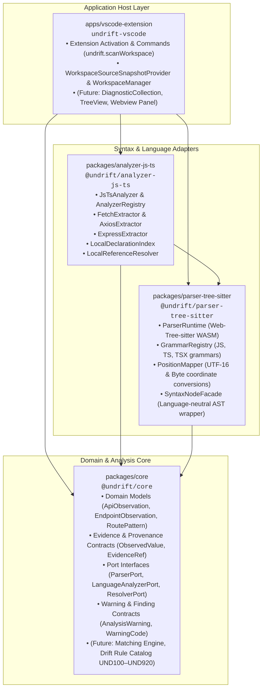
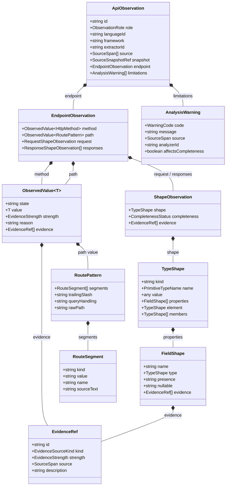

# UNDRIFT

> **Live frontend-backend API contract intelligence inside the developer workspace.**

[](packages/core)
[](package.json)
[](packages/parser-tree-sitter)
[](tests)
[](docs/HLD.md)
[](docs/LLD.md)

UNDRIFT is an IDE-first developer tool engineered to discover integration contracts between connected parts of an application, detect when those contracts drift, explain discrepancies using source-linked evidence, and prepare reviewable repairs directly where developers write code.

Connected application layers frequently evolve at different paces: a frontend client call and a backend route handler can each be locally well-typed and syntactically valid while disagreeing completely at the integration boundary. UNDRIFT addresses this gap through static source-code analysis. By combining Web-Tree-sitter Abstract Syntax Tree (AST) parsing with language-specific contract extractors and same-document constant resolution, UNDRIFT models integration contracts deterministically, preserving qualitative evidence and uncertainty without sending code to cloud services or executing application runtimes.

---

## Table of Contents

- [What Is UNDRIFT?](#what-is-undrift)
- [The Problem and Motivation](#the-problem-and-motivation)
- [Project Status and Current Capabilities](#project-status-and-current-capabilities)
- [Core Workflow](#core-workflow)
- [Architecture Overview](#architecture-overview)
- [Observation and Data Model](#observation-and-data-model)
- [Supported Extraction Patterns](#supported-extraction-patterns)
- [Technology Stack](#technology-stack)
- [Repository Structure](#repository-structure)
- [Getting Started](#getting-started)
- [Developer Workflow and Quality Checks](#developer-workflow-and-quality-checks)
- [Configuration](#configuration)
- [Design Decisions and Engineering Principles](#design-decisions-and-engineering-principles)
- [Current Limitations](#current-limitations)
- [Roadmap](#roadmap)
- [Documentation Guide](#documentation-guide)
- [Contributing and Development Notes](#contributing-and-development-notes)
- [License and Project Links](#license-and-project-links)

---

## What Is UNDRIFT?

In full-stack and distributed web applications, frontend user interfaces and backend services are routinely authored across different files, folders, or repositories—often by different developers, distinct teams, or generative AI coding assistants.

Each component appears valid in isolation:

- A frontend client call compiles cleanly under TypeScript or bundles without JavaScript syntax errors.
- A backend route handler starts up, parses requests, and compiles without warnings.

Yet at the integration seam, their implicit assumptions can quietly diverge. A backend route might rename an identifier (`userName` to `user_name`), restructure an object into a nested payload, alter a route parameter, or change an HTTP method from `POST` to `PATCH`. Because compile-time checks traditionally terminate at process and network boundaries unless strict, end-to-end type generation is enforced, these mismatches escape to runtime—surfacing as `undefined` UI states, HTTP 404/405 errors, broken user flows, and costly debugging sessions.

### The UNDRIFT Approach

UNDRIFT bridges this gap directly inside the developer's local development environment:

1. **Local-First Static Analysis:** Analyzes source text directly within the workspace using [Web-Tree-sitter](https://github.com/tree-sitter/tree-sitter) WebAssembly (WASM) grammars. Analysis requires zero external network calls, zero cloud services, zero external databases, and zero LLM API keys for standard contract discovery.
2. **Deterministic Extraction:** Scans consumer calls (such as `fetch()` and `axios`) and provider handlers (such as Express `app.get()` or `router.post()`) into structured, language-neutral API observations.
3. **Evidence-Backed Modeling:** Every extracted HTTP method, route pattern, status code, and payload shape is anchored to exact UTF-16 source spans and qualitative evidence classifications (`direct`, `resolved`, `inferred`, or `unknown`).
4. **Uncertainty Preservation:** When dynamic initializers, complex expressions, or unresolved imports prevent exact deduction, UNDRIFT explicitly records uncertainty rather than guessing or generating false-positive warnings.

> **Current Implementation Boundary:**  
> UNDRIFT has completed **Phase 1** (Workspace Discovery and Parser Foundation) and **Phase 2** (Analyzer Contracts, Registry, JS/TS API Extraction, Local Declaration Indexing, and Same-Document Constant Resolution).  
> Downstream capabilities—including automated consumer-provider candidate matching, drift detection rules, fix generation, session persistence, and full VS Code diagnostics UI—are scheduled for **Phase 3 and subsequent releases**.

---

## The Problem and Motivation

Consider a typical web application feature connecting a TypeScript React client to an Express server:

### Frontend Consumer (`src/client/users.ts`)

```ts
// Developer expects a User object with a camelCase property:
interface UserProfile {
  id: string;
  userName: string;
}

export async function fetchUserProfile(userId: string): Promise<UserProfile> {
  const response = await fetch(`/api/users/${userId}`);
  return response.json();
}
```

### Backend Provider (`src/server/routes.ts`)

```ts
// Backend endpoint returns snake_case database columns:
app.get("/api/users/:id", (req, res) => {
  res.json({
    id: req.params.id,
    user_name: "Ada Lovelace",
    status: "active"
  });
});
```

### What Happens Today vs. What UNDRIFT Observes

- **Without UNDRIFT:** The frontend compiles without error because `response.json()` returns `any` or casts to `UserProfile`. At runtime, UI code reading `data.userName` renders `undefined` or crashes. The developer must manually trace network tabs, log statements, and backend route code to find the mismatch.
- **Under UNDRIFT's Current Phase 2 Extraction:**
  - The **Fetch extractor** identifies the client call, parses the static route `/api/users/`, flags the dynamic segment `${userId}` as a parameter segment, sets the HTTP method to `GET` (via standard fetch conventions), and records the source location.
  - The **Express extractor** identifies the route registration `app.get`, extracts the route pattern `/api/users/:id` with parameter segment `id`, records the default 200 status code, and extracts the inline response object shape containing properties `id`, `user_name`, and `status`.
  - Both observations are recorded as normalized `ApiObservation` structures with precise source spans and content hashes.
- **Under Future Matching and Drift Rules (Phase 3 & Phase 4):**
  - The **Matching Engine** correlates the two endpoints based on structural route compatibility (`/api/users/:param` ↔ `/api/users/:param`) and identical HTTP `GET` methods.
  - The **Drift Engine** evaluates response shape compatibility (Rule `UND300` / `UND310`), detecting that the consumer expects property `userName` while the provider returns `user_name`.
  - An in-editor diagnostic and reviewable Quick Fix proposal pinpoint both files with line-level evidence.

_Note: The cross-component comparison and drift diagnostic described above represent documented future capabilities; the current codebase extracts and indexes both sides but does not yet execute matching or drift rules._

---

## Project Status and Current Capabilities

The following table reflects the verified status of the codebase across automated tests and source implementations:

| Capability                            | Status          | What Is Supported Today                                                                                                                                                                                                                                                    | Known Boundaries & Deferred Behavior                                                                                                                     |
| ------------------------------------- | --------------- | -------------------------------------------------------------------------------------------------------------------------------------------------------------------------------------------------------------------------------------------------------------------------- | -------------------------------------------------------------------------------------------------------------------------------------------------------- |
| **Workspace Source Discovery**        | **Implemented** | Recursive discovery of `.js`, `.mjs`, `.cjs`, `.jsx`, `.ts`, `.tsx` files; built-in exclusion glob filtering (`node_modules`, `.git`, `dist`, `build`, etc.); editor buffer priority over disk; deterministic SHA-256 snapshot hashing.                                    | Multi-root workspace discovery is coordinated through `WorkspaceSourceSnapshotProvider`; non-standard file extensions are ignored.                       |
| **Tree-sitter Parser Foundation**     | **Implemented** | `web-tree-sitter` WebAssembly runtime; grammar registry caching WASM binaries for JavaScript, TypeScript, and TSX; `PositionMapper` with bidirectional UTF-16 code unit and byte offset mapping; `SyntaxNodeFacade` navigation.                                            | WASM binaries are loaded from disk or bundled extension assets; incremental re-parsing across text edits is scaffolded behind the facade.                |
| **Analyzer Domain Contracts & Ports** | **Implemented** | Standardized language-neutral domain contracts (`ApiObservation`, `EndpointObservation`, `RoutePattern`, `ObservedValue<T>`, `TypeShape`, `EvidenceRef`, `AnalysisWarning`); port definitions for parsers, analyzers, and resolvers.                                       | Domain contracts are decoupled from editor APIs and compiler internals.                                                                                  |
| **Analyzer Registry**                 | **Implemented** | Deterministic analyzer registration, deduplication, lookup, and dispatch based on document URI and language ID (`AnalyzerRegistry`, `JsTsAnalyzer`).                                                                                                                       | Dynamic plugin loading from external npm packages is deferred.                                                                                           |
| **Standard Fetch Extraction**         | **Implemented** | Direct `fetch("/url")` and `fetch(url, options)` calls; default `GET` method; explicit uppercase and lowercase HTTP methods; static template literals; parameter colon syntax; JSON request payload shapes via object literals; trailing slash and query string exclusion. | Generic wrapper functions require explicit configuration or resolution; dynamic URL concatenation without literals is marked `unknown`.                  |
| **Axios Method Call Extraction**      | **Implemented** | Method invocations (`axios.get`, `axios.post`, `axios.put`, `axios.delete`, `axios.patch`); request body object literals; TypeScript response type arguments (`axios.get<User>(...)`); static and template literal paths.                                                  | Custom Axios instance creators (`axios.create()`) and base URLs require cross-file declaration resolution.                                               |
| **Express Route Extraction**          | **Implemented** | `app.<method>` and `router.<method>` declarations for `get`, `post`, `put`, `delete`, `patch`; path literals and parameter segments (`:id`); chained `res.status().json()` and direct `res.json()`; inline response object shapes.                                         | Router mount prefixes (`app.use('/api', router)`) require cross-file resolution; regex routes and dynamic route factories emit `DYNAMIC_ROUTE` warnings. |
| **Local Declaration Indexing**        | **Implemented** | Single-document indexing of variable declarations (`const`, `let`, `var`), functions, type aliases, interfaces, and imports (`import`, `require`).                                                                                                                         | Symbol indexing is scoped per-document snapshot; project-wide cross-file symbol indexing is a Phase 3 gate.                                              |
| **Same-Document Constant Resolution** | **Implemented** | Evaluates identifier references to same-document `const` declarations (strings, numbers, booleans, null); attaches `resolved` evidence; marks mutable (`let`/`var`), dynamic, or ambiguous bindings as `unresolved`/`unknown`.                                             | Import declarations and cross-file references are identified and explicitly classified as `unsupported` (deferred POC Gates).                            |
| **Consumer-Provider Matching**        | **Planned**     | Algorithmic candidate matching (Exact route/method, Method conflict, Suspected route mismatch) designed in LLD Section 10.                                                                                                                                                 | No matching engine executed in current pipeline.                                                                                                         |
| **Deterministic Drift Rules**         | **Planned**     | Rule catalog defined in LLD Section 11 (`UND100`–`UND920` / `DRIFT-001`–`DRIFT-008`).                                                                                                                                                                                      | Core rules directory contains specifications and stubs (`packages/core/src/rules/`).                                                                     |
| **Explanation & Repair Proposals**    | **Planned**     | Multi-level repair semantics (Mechanical, Reviewed, Manual) designed in PRD Section 13 and LLD Section 12–13.                                                                                                                                                              | Core explanation and fix proposal packages are scaffolded for Phase 4.                                                                                   |
| **Session State Persistence**         | **Planned**     | Crash-safe workspace storage persistence (`storageUri` / `workspaceState`) and finding lifecycle tracking (`detected`, `changed`, `resolved`, `reintroduced`) designed in HLD/LLD.                                                                                         | Persistence layer not active in current build; no state is written to disk across runs.                                                                  |
| **VS Code User Interface**            | **Partial**     | `undrift.scanWorkspace` command registered and functional; extension bundles cleanly with all WASM assets.                                                                                                                                                                 | Diagnostic collections, findings sidebar tree view, and webview integration reports are scaffolded for Phase 6.                                          |

---

## Core Workflow

The end-to-end design of UNDRIFT follows a 10-stage unidirectional pipeline. Stages 1 through 6 represent the verified implementation boundary of Phases 1 and 2, while Stages 7 through 10 represent the downstream architecture planned for Phases 3 through 6.

```mermaid
flowchart TD
    subgraph Implemented ["Phases 1 & 2: Implemented & Verified Foundation"]
        A["1. Workspace Source Discovery<br/><code>WorkspaceSourceSnapshotProvider</code><br/><i>Discovers files, applies globs, hashes content</i>"]
        B["2. Tree-sitter AST Parsing<br/><code>TreeSitterParserAdapter</code><br/><i>Loads WASM grammars, parses syntax nodes</i>"]
        C["3. AST Feature Extraction<br/><code>FetchExtractor</code> / <code>AxiosExtractor</code> / <code>ExpressExtractor</code><br/><i>Extracts methods, routes, and literal shapes</i>"]
        D["4. Local Declaration Indexing<br/><code>LocalDeclarationIndex</code><br/><i>Indexes same-document variables, functions, types</i>"]
        E["5. Same-Document Constant Resolution<br/><code>LocalReferenceResolver</code><br/><i>Resolves const identifiers to static literal values</i>"]
        F["6. Normalized API Observations<br/><code>ApiObservation</code> Domain Objects<br/><i>Carries UTF-16 spans, evidence kind & strength</i>"]

        A --> B
        B --> C
        C --> D
        D --> E
        E --> F
    end

    subgraph Planned ["Phases 3–6: Planned Downstream Pipeline"]
        G["7. Protocol & Shape Normalization<br/><code>RouteNormalizer</code> & <code>TypeNormalizer</code><br/><i>Canonicalizes segments, primitives, and nullability</i>"]
        H["8. Consumer-Provider Matching<br/><code>CandidateMatcher</code><br/><i>Exact match, method conflict, suspected route drift</i>"]
        I["9. Deterministic Drift Detection<br/>Rule Catalog <code>UND100</code>–<code>UND920</code><br/><i>Evaluates route, method, request, and response drift</i>"]
        J["10. Explanation & Fix Generation<br/><code>ExplanationEngine</code> & <code>FixGenerator</code><br/><i>Produces structured findings and reviewable edits</i>"]
        K["11. Session State Reconciliation<br/><code>StateReconciliationManager</code><br/><i>Derives lifecycle events: detected, changed, resolved</i>"]
        L["12. IDE Presentation & Verification<br/>VS Code Diagnostics, Views & Reports<br/><i>In-editor squiggles, sidebar tree, re-analysis</i>"]

        F -.-> G
        G -.-> H
        H -.-> I
        I -.-> J
        J -.-> K
        K -.-> L
    end

    style Implemented fill:#0f172a,stroke:#3b82f6,stroke-width:2px,color:#f8fafc
    style Planned fill:#0b0f19,stroke:#64748b,stroke-width:2px,stroke-dasharray: 5 5,color:#94a3b8
```



### Stage Explanations

1. **Workspace Source Discovery:** Collects all supported JavaScript/TypeScript source files within active workspace folders, prioritizing dirty in-memory editor buffers over stale disk files, and fingerprints each document with a SHA-256 hash.
2. **Tree-sitter AST Parsing:** Translates source text into structured syntax trees via `web-tree-sitter` WebAssembly grammars, mapping byte positions to UTF-16 editor ranges via `PositionMapper`.
3. **AST Feature Extraction:** AST extractors locate invocation and route patterns matching the canonical support matrix, extracting raw methods, paths, and payload literals.
4. **Local Declaration Indexing:** Catalogs declaration identifiers within the document snapshot to identify constants, variables, imports, and type definitions.
5. **Same-Document Constant Resolution:** Evaluates references (e.g., `fetch(API_ROUTE)`) against declared constants, promoting static string/numeric literals to resolved values with provenance evidence.
6. **Normalized API Observations:** Emits immutable `ApiObservation` objects containing endpoint metadata, source spans, and analysis limitations.
7. **Protocol & Shape Normalization (Planned):** Normalizes route paths (handling slashes, parameters, and casing) and maps type structures to a common type system.
8. **Consumer-Provider Matching (Planned):** Generates candidate pairs between frontend consumers and backend providers using exact route equivalence, method mismatches, or conservative single-segment divergence heuristics.
9. **Deterministic Drift Detection (Planned):** Executes compatibility rules against candidate relationships to identify missing providers, method conflicts, or payload shape mismatches.
10. **Explanation & Fix Generation (Planned):** Generates human-readable explanations linking both source locations and constructs reviewable workspace edit proposals.
11. **Session State Reconciliation (Planned):** Reconciles newly produced findings against the last known complete analysis snapshot, emitting lifecycle transitions (`detected`, `changed`, `resolved`, `reintroduced`).
12. **IDE Presentation & Verification (Planned):** Publishes findings to VS Code's `DiagnosticCollection`, updates the explorer tree view, and re-analyzes source code after edits are applied to verify resolutions.

---

## Architecture Overview

UNDRIFT is structured as an npm workspaces monorepo separating editor presentation, language parsing, syntax extraction, and core domain intelligence into independent packages:



### Component Responsibility Table

| Component / Package               | Responsibility                                                                                                                                 | Current Status                                                | Relevant Source                                                                        |
| --------------------------------- | ---------------------------------------------------------------------------------------------------------------------------------------------- | ------------------------------------------------------------- | -------------------------------------------------------------------------------------- |
| **`@undrift/core`**               | Language-neutral domain contracts, ports, uncertainty models, evidence provenance, and rule definitions. Never imports VS Code or Tree-sitter. | **Implemented** (contracts & ports); matching & rules planned | [`packages/core/src/index.ts`](packages/core/src/index.ts)                             |
| **`@undrift/parser-tree-sitter`** | Lifecycle management for Web-Tree-sitter WASM runtimes, grammar loading, AST facades, and UTF-16 code-unit coordinate mapping.                 | **Implemented**                                               | [`packages/parser-tree-sitter/src/index.ts`](packages/parser-tree-sitter/src/index.ts) |
| **`@undrift/analyzer-js-ts`**     | JavaScript/TypeScript API extraction (`fetch`, `axios`, `express`), local declaration indexing, and same-document constant resolution.         | **Implemented**                                               | [`packages/analyzer-js-ts/src/index.ts`](packages/analyzer-js-ts/src/index.ts)         |
| **`undrift-vscode`**              | VS Code extension host adapter, workspace source discovery, document tracking, command registration, and future UI presentation.               | **Implemented** (workspace discovery); UI planned             | [`apps/vscode-extension/src/extension.ts`](apps/vscode-extension/src/extension.ts)     |

---

## Observation and Data Model

UNDRIFT's core analysis engine operates on language-neutral, evidence-backed observation contracts defined in `@undrift/core`.



### Key Domain Concepts

- **`ApiObservation`:** Represents a single extracted API fact from source code, classified by role:
  - `consumer`: A frontend client call expecting certain request and response behaviors.
  - `provider`: A backend endpoint handler offering specific route and response behaviors.
- **`ObservedValue<T>`:** A tagged union representing a value whose knowledge state matters for analysis decisions:
  - `{ state: "known", value: T, strength, evidence }`: Deterministically known through direct syntax or resolved references.
  - `{ state: "dynamic", expression, reason, evidence }`: Built from dynamic runtime expressions (e.g., function calls, arithmetic).
  - `{ state: "unknown", reason, evidence }`: Unresolved or unanalyzable with current information.
- **Evidence & Provenance:** Every observation retains `EvidenceRef` items pointing to exact `SourceSpan` coordinates, an `EvidenceSourceKind` (`literal-syntax`, `local-declaration`, `framework-convention`, etc.), and a qualitative `EvidenceStrength` (`direct`, `resolved`, `inferred`, `unknown`).
- **`RoutePattern` & Segments:** Structured route representation breaking URLs into segments:
  - `static`: Exact path string literal (e.g., `api`, `users`).
  - `parameter`: Variable path parameter (e.g., `:id` in Express or `${id}` in template strings).
  - `wildcard`: Catch-all wildcard segments (`*`).
  - `unresolved`: Segments that cannot be statically determined.
- **`TypeShape` Model:** A recursive, structural type representation supporting primitives (`string`, `number`, `boolean`, `null`, `undefined`), literals, arrays, objects with field-level presence (`required`, `optional`, `unknown`) and nullability (`yes`, `no`, `unknown`), unions, and named type references.
- **Analysis Warnings (`AnalysisWarning`):** Non-fatal diagnostics (`PARSE_ERROR`, `UNSUPPORTED_PATTERN`, `UNRESOLVED_REFERENCE`, `DYNAMIC_ROUTE`, `PARTIAL_SHAPE`, `INCOMPLETE_SCOPE`) attached to observations. Warnings communicate boundaries and completeness limits without falsely classifying unsupported code as drift.

> **In-Memory vs. Persisted Data Models:**  
> The models above represent in-memory domain contracts produced during active analysis. The [ERD Specification](docs/ERD.md) additionally defines the logical model for multi-session persistence (`ANALYSIS_SNAPSHOT`, `FINDING_LIFECYCLE_EVENT`), which will be stored in VS Code-managed workspace storage in Phase 5 without creating repository-polluting `.undrift/` directories.

---

## Supported Extraction Patterns

UNDRIFT's JavaScript/TypeScript analyzer catalogs pattern recognition capabilities in [`support-matrix.ts`](packages/analyzer-js-ts/src/support-matrix.ts). All six canonical patterns are implemented and verified by automated tests:

| Pattern ID | Role | Language | Framework | Supported Behaviors | Known Limitations & Boundaries | Verification Status |
|---|---|---|---|---|---|
| **`fetch-standard-call`** | Consumer | JavaScript | `fetch` | `fetch("/api/users")`<br/>`fetch("/api/users", { method: "POST", body: JSON.stringify({...}) })`<br/>Default `GET` method; static template literals; parameter colon syntax; query string stripping; trailing slash detection. | Dynamic URL variables without local constant resolution marked `unknown`; custom fetch wrapper functions require explicit support; request payload extraction limited to direct `JSON.stringify` object literals. | **Tested** (`fetch-extractor.test.ts`) |
| **`fetch-standard-call-ts`** | Consumer | TypeScript | `fetch` | Same as JS plus TypeScript syntax, TSX source files, and TypeScript AST position mapping. | Generic fetch wrappers with complex return types require project-wide symbol resolution. | **Tested** (`fetch-extractor.test.ts`) |
| **`axios-method-call`** | Consumer | JavaScript | `axios` | `axios.get("/api/users")`<br/>`axios.post("/api/users", payload)`<br/>Direct method calls (`get`, `post`, `put`, `delete`, `patch`); object literal request bodies. | Dynamic method invocation (`axios[method]()`) marked `unresolved`; custom Axios instance creators (`axios.create()`) and base URLs require cross-file resolution. | **Tested** (`axios-extractor.test.ts`) |
| **`axios-method-call-ts`** | Consumer | TypeScript | `axios` | Same as JS plus generic type parameter extraction:<br/>`axios.get<User[]>("/api/users")`<br/>`axios.post<UserResponse>("/api/users", body)` | Mapped or conditional type parameters marked partial/unresolved. | **Tested** (`axios-extractor.test.ts`) |
| **`express-route-declaration`** | Provider | JavaScript | Express | `app.get("/api/users", handler)`<br/>`router.post("/api/users", handler)`<br/>Direct `res.json(...)` and chained `res.status(200).json(...)`; inline response object shapes; route parameters (`:id`). | Router mount prefixes (`app.use('/api', router)`) require cross-file resolution; regex routes or array paths marked unsupported; dynamic route loops marked `DYNAMIC_ROUTE`. | **Tested** (`express-extractor.test.ts`) |
| **`express-route-declaration-ts`** | Provider | TypeScript | Express | Same as JS plus TypeScript route handlers with explicit type annotations on request/response parameters (`req: Request, res: Response`). | External controller functions referenced across files require cross-file AST indexing. | **Tested** (`express-extractor.test.ts`) |

### Same-Document Constant Resolution in Extractors

When an endpoint path references an identifier rather than an inline string literal, UNDRIFT's `LocalReferenceResolver` evaluates the symbol against the document's `LocalDeclarationIndex`:

```ts
// Successfully resolved to known path "/api/v1/users" with "resolved" evidence:
const USERS_ENDPOINT = "/api/v1/users";
fetch(USERS_ENDPOINT);

// Evaluated as "unknown" with UNRESOLVED_REFERENCE warning:
let dynamicEndpoint = "/api/v1/users"; // Mutable 'let' binding
fetch(dynamicEndpoint);

// Evaluated as "unsupported" (Deferred POC Gate):
import { USERS_API } from "./config"; // Cross-file imported constant
fetch(USERS_API);
```

---

## Technology Stack

The UNDRIFT codebase is built exclusively with modern, standards-based developer tooling:

| Category               | Technology                                                                                | Version      | Purpose in UNDRIFT                                                                                                          |
| ---------------------- | ----------------------------------------------------------------------------------------- | ------------ | --------------------------------------------------------------------------------------------------------------------------- |
| **Language & Runtime** | [TypeScript](https://www.typescriptlang.org/)                                             | `^5.9.3`     | Primary implementation language across all packages, compiler types, and domain contracts.                                  |
| **Language & Runtime** | [Node.js](https://nodejs.org/)                                                            | `>= 18.0.0`  | Target execution environment for package builds, testing, and the VS Code Extension Host.                                   |
| **Monorepo Tooling**   | [npm Workspaces](https://docs.npmjs.com/cli/using-npm/workspaces)                         | `>= 9.0.0`   | Monorepo package management, dependency hoisting, and cross-package workspace linking.                                      |
| **Parsing Engine**     | [web-tree-sitter](https://github.com/tree-sitter/tree-sitter/tree/master/lib/binding_web) | `^0.20.8`    | WebAssembly-based Tree-sitter binding providing fast, incremental AST parsing without native C++ compilation.               |
| **Grammar Binaries**   | [tree-sitter-wasms](https://github.com/GoldsteinE/tree-sitter-wasms)                      | `^0.1.13`    | Precompiled WebAssembly grammars for JavaScript, TypeScript, and TSX.                                                       |
| **Extension Bundler**  | [esbuild](https://esbuild.github.io/)                                                     | `^0.25.12`   | High-speed bundler bundling the VS Code extension into a single distribution file (`extension.js`) and copying WASM assets. |
| **Editor Host**        | [VS Code API](https://code.visualstudio.com/api)                                          | `>= 1.100.0` | Target editor host for workspace discovery, commands, diagnostics, and future views.                                        |
| **Testing Framework**  | [Vitest](https://vitest.dev/)                                                             | `^3.2.7`     | Monorepo test runner executing 279 unit and integration tests across 16 test suites.                                        |
| **Code Quality**       | [ESLint](https://eslint.org/)                                                             | `^10.12.0`   | Static code analysis and linting enforcing repository-wide coding standards.                                                |
| **Code Formatter**     | [Prettier](https://prettier.io/)                                                          | `^3.9.10`    | Opinionated code formatting across all TypeScript, JavaScript, JSON, and Markdown files.                                    |

---

## Repository Structure

```text
UNDRIFT-SourceCode/
├── apps/
│   └── vscode-extension/              # VS Code extension application host
│       ├── src/
│       │   ├── activation/            # Extension activation and lifecycle coordination
│       │   ├── commands/              # VS Code command registrations (undrift.scanWorkspace)
│       │   ├── diagnostics/           # In-editor diagnostic collections (stubs for Phase 6)
│       │   ├── fixes/                 # Workspace edit appliers (stubs for Phase 6)
│       │   ├── logging/               # Output channel and structured logging
│       │   ├── views/                 # Findings tree view and report webview (stubs for Phase 6)
│       │   ├── workspace/             # WorkspaceSourceSnapshotProvider & WorkspaceManager
│       │   └── extension.ts           # Extension entry point
│       ├── esbuild.config.mjs         # Bundler script copying WASM assets and producing dist/
│       ├── package.json               # Extension manifest and contributions
│       └── tsconfig.json
├── packages/
│   ├── core/                          # @undrift/core: Language-neutral domain contracts
│   │   ├── src/
│   │   │   ├── config/                # ResolvedUndriftConfig schema contracts
│   │   │   ├── domain/                # ApiObservation, EndpointObservation, TypeShape, EvidenceRef
│   │   │   ├── explanations/          # Explanation data models (stubs for Phase 4)
│   │   │   ├── fixes/                 # FixProposal contracts (stubs for Phase 4)
│   │   │   ├── matching/              # Candidate relationship models (stubs for Phase 3)
│   │   │   ├── normalization/         # Normalization port contracts (stubs for Phase 3)
│   │   │   ├── pipeline/              # Analysis engine pipeline contracts (stubs for Phase 3)
│   │   │   ├── ports/                 # ParserPort, LanguageAnalyzerPort, SemanticResolverPort
│   │   │   ├── reporting/             # Integration report models (stubs for Phase 5)
│   │   │   ├── rules/                 # Drift rule engine & catalog stubs (UND100–UND920)
│   │   │   └── index.ts               # Core package exports
│   │   ├── package.json
│   │   └── tsconfig.json
│   ├── parser-tree-sitter/            # @undrift/parser-tree-sitter: Tree-sitter WASM adapter
│   │   ├── src/
│   │   │   ├── grammar-registry/      # WASM grammar asset discovery and caching
│   │   │   ├── runtime/               # Web-Tree-sitter lifecycle and memory management
│   │   │   ├── syntax-view/           # SyntaxNodeFacade language-neutral AST wrapper
│   │   │   ├── errors.ts              # Tree-sitter runtime and grammar errors
│   │   │   ├── parser.ts              # TreeSitterParserAdapter implementing ParserPort
│   │   │   ├── position-mapping.ts    # PositionMapper (UTF-16 code units ↔ byte offsets)
│   │   │   └── index.ts
│   │   ├── test/                      # Parser unit tests (runtime, mapping, facade)
│   │   ├── package.json
│   │   └── tsconfig.json
│   └── analyzer-js-ts/                # @undrift/analyzer-js-ts: JS/TS contract extractors
│       ├── src/
│       │   ├── backend/               # ExpressExtractor (Express route & response extraction)
│       │   ├── frontend/              # FetchExtractor & AxiosExtractor (Client calls)
│       │   ├── project-index/         # LocalDeclarationIndex & LocalReferenceResolver
│       │   ├── registry/              # AnalyzerRegistry & JsTsAnalyzer
│       │   ├── shapes/                # Type and shape extractors
│       │   ├── support-matrix.ts      # Canonical pattern catalog and query APIs
│       │   └── index.ts
│       ├── package.json
│       └── tsconfig.json
├── docs/                              # Authoritative architecture and specifications
│   ├── PRD.md                         # Product Requirements Document
│   ├── TRD.md                         # Technical Requirements Document
│   ├── ERD.md                         # Entity Relationship Diagram & Logical Model
│   ├── HLD.md                         # High-Level Design
│   ├── LLD.md                         # Low-Level Design
│   └── DEVELOPMENT.md                 # Monorepo setup and developer workflow
├── examples/                          # Reserved sample projects for drift demonstrations
│   ├── api-drift-sample/              # Planned full-stack sample application
│   └── ecommerce-demo/                # Planned e-commerce integration demo
├── tests/                             # Test suites across monorepo packages
│   ├── analyzer/                      # Extractor and resolver unit/integration tests
│   ├── core/                          # Core domain contracts, ports, and registry tests
│   ├── extension-host/                # Reserved for future VS Code extension host tests
│   ├── fixtures/                      # Reserved for static source fixtures
│   ├── integration/                   # Workspace and parser integration tests
│   ├── scenarios/                     # Reserved for future end-to-end drift scenarios
│   └── workspace/                     # WorkspaceSourceSnapshotProvider tests
├── package.json                       # Monorepo root manifest, scripts, and devDependencies
├── tsconfig.base.json                 # Shared base TypeScript configuration
├── vitest.config.ts                   # Vitest root test configuration
└── eslint.config.mjs                  # ESLint flat configuration
```

---

## Getting Started

### Prerequisites

- **Node.js**: `>= 18.0.0` (Node.js 22 LTS recommended)
- **npm**: `>= 9.0.0`
- **VS Code**: `>= 1.100.0` (required for extension debugging)

### Installation & Setup

1. **Clone the repository:**

   ```bash
   git clone https://github.com/parnilV06/undrift.git
   cd undrift
   ```

2. **Install monorepo dependencies:**

   ```bash
   npm install
   ```

3. **Typecheck all packages and applications:**

   ```bash
   npm run typecheck
   ```

4. **Build packages and bundle the VS Code extension:**

   ```bash
   npm run build
   ```

   _This compiles all TypeScript packages and bundles the VS Code extension via esbuild, copying required WebAssembly grammars (`tree-sitter.wasm`, `tree-sitter-javascript.wasm`, `tree-sitter-typescript.wasm`, and `tree-sitter-tsx.wasm`) into `apps/vscode-extension/dist/wasm/`._

5. **Run the test suite:**
   ```bash
   npm test
   ```

### Launching the VS Code Extension (Development Mode)

To launch an Extension Development Host instance:

1. Open this repository folder in VS Code.
2. Ensure you have run `npm run build`.
3. Switch to the **Run and Debug** view (`Ctrl+Shift+D` / `Cmd+Shift+D`).
4. Select **Launch Extension** from the dropdown and press `F5`.
5. In the new Extension Host window, open any JavaScript/TypeScript workspace.
6. Open the Command Palette (`Ctrl+Shift+P` / `Cmd+Shift+P`) and execute:
   ```text
   UNDRIFT: Scan Workspace
   ```
   _The extension will discover all supported source files, acquire clean in-memory snapshots, compute content hashes, and display a notification with the file count and acquisition status._

---

## Developer Workflow and Quality Checks

UNDRIFT enforces strict type safety, linting, formatting, and test coverage across all packages. Contributors should use the following root package scripts:

| Command                | Scope    | Description                                                         |
| ---------------------- | -------- | ------------------------------------------------------------------- |
| `npm test`             | Monorepo | Runs Vitest across all 16 test files (279 tests).                   |
| `npm run typecheck`    | Monorepo | Runs `tsc -p tsconfig.json --noEmit` across all workspaces.         |
| `npm run build`        | Monorepo | Compiles all packages and bundles `apps/vscode-extension`.          |
| `npm run lint`         | Monorepo | Runs ESLint 10 with `typescript-eslint` across the entire codebase. |
| `npm run format:check` | Monorepo | Validates formatting across all files using Prettier.               |

### Running Checks for Specific Workspaces

You can target individual workspaces using npm's `--workspace` flag:

```bash
# Typecheck only @undrift/core
npm run typecheck --workspace=@undrift/core

# Typecheck only @undrift/analyzer-js-ts
npm run typecheck --workspace=@undrift/analyzer-js-ts

# Build only the VS Code extension
npm run build --workspace=undrift-vscode
```

### Test Suite Organization

- `tests/core/`: Validates domain contracts, port specifications, analyzer registry, and support matrix definitions.
- `packages/parser-tree-sitter/test/`: Validates WASM runtime initialization, byte/UTF-16 position mapping, and AST facades.
- `tests/workspace/`: Tests `WorkspaceSourceSnapshotProvider` file discovery, exclusion globs, and document hashing.
- `tests/analyzer/`: Unit tests for Fetch, Axios, and Express extractors, local declaration indexing, and constant resolution.
- `tests/integration/`: Validates workspace snapshots piped directly through the Tree-sitter parser and analyzer extractors.

---

## Configuration

Project configuration contracts are specified in [`packages/core/src/config/undrift-config.ts`](packages/core/src/config/undrift-config.ts) and described in [LLD Section 4.4 and Section 14](docs/LLD.md):

```ts
export interface ResolvedUndriftConfig {
  readonly version?: number;
  readonly include?: readonly string[];
  readonly exclude?: readonly string[];
  readonly analyzers?: {
    readonly [name: string]: boolean | undefined;
  };
  readonly [key: string]: unknown;
}
```

### Current Status of Configuration

- **Built-in Workspace Exclusion Defaults:** In the current phase, [`source-snapshot-provider.ts`](apps/vscode-extension/src/workspace/source-snapshot-provider.ts) enforces standard exclusion globs (`DEFAULT_EXCLUDE_GLOBS`) covering `node_modules`, `.git`, `dist`, `build`, `out`, `coverage`, `.turbo`, `.next`, `.nuxt`, `.cache`, and minified files (`*.min.js`).
- **Custom Configuration Files:** A versioned `.undrift/` project configuration format is planned for Phase 5 to support custom include/exclude globs, rule toggles, and intentional mapping definitions. In the current Phase 2 codebase, default exclusions and programmatic options are utilized.

---

## Design Decisions and Engineering Principles

1. **Local-First Analysis:** All source code parsing and contract extraction execute locally within the developer's machine. No source code or derived contract models are uploaded to external services.
2. **Parser and Analyzer Separation:** Web-Tree-sitter provides raw syntax parsing; it has no knowledge of HTTP routes, Express conventions, or API contracts. Language-specific analyzers translate raw syntax into normalized domain observations.
3. **Language-Neutral Core:** Contract models (`ApiObservation`), candidate matching, drift rules, and fix proposals in `@undrift/core` are completely decoupled from Tree-sitter syntax nodes and TypeScript compiler types. Adding a new language or framework requires only an analyzer adapter, not changes to core matching algorithms.
4. **Evidence Travels with Facts:** Every extracted property (method, path, body, status code) carries explicit `EvidenceRef` records, UTF-16 source ranges, and an `EvidenceStrength` rating (`direct`, `resolved`, `inferred`, or `unknown`).
5. **Conservative Uncertainty ("Unknown Is Not False"):** When an extractor encounters dynamic code (e.g., dynamic URL concatenation, unresolvable variables), it marks the observation `unknown` or `dynamic` with an `AnalysisWarning`. UNDRIFT never treats an unresolvable value as proof of absence or drift.
6. **Same-Document Constant Resolution vs. Cross-File Gates:** The system resolves same-document constant literals to handle real-world patterns like `const API = "/users"; fetch(API);`. Cross-file import dereferencing and module alias resolution are designated **POC Gates** in the TRD and are deliberately deferred to prevent unreliable approximations.
7. **No Repository History Pollution:** Analysis state and finding lifecycle history are designed for VS Code-managed workspace storage (`storageUri` / `workspaceState`), not a `.undrift/` directory committed to the user's project git repository.

---

## Current Limitations

UNDRIFT prioritizes technical honesty over exaggerated claims. The following limitations apply to the current implementation:

- **Language & Framework Scope:** Extraction is currently limited to JavaScript and TypeScript projects using standard `fetch()`, `axios`, or Express route handlers (`app.<method>`, `router.<method>`). Alternative frameworks (e.g., Fastify, NestJS, Next.js App Router, Koa) and other languages (Python, Go) are not yet supported.
- **Syntactic Extraction Boundaries:** Extractors rely on recognizable AST patterns. Dynamic HTTP method dispatch (`axios[method]()`), dynamic route loops (`methods.forEach(...)`), regex route patterns, and complex custom wrapper functions without local literals are marked `unknown` or emit warnings.
- **Local-Only Symbol Resolution:** Constant resolution operates exclusively within the same document snapshot. Imported constants (`import { API } from './config'`) and CommonJS `require()` bindings are recognized as imports but marked `unsupported` (deferred POC Gates).
- **Matching & Drift Detection:** Candidate consumer-provider matching and drift detection rules (`UND100`–`UND920`) are designed in the specifications but are not executed in the current build.
- **VS Code Extension UI:** The VS Code extension currently registers and executes the workspace scan command (`undrift.scanWorkspace`). Findings tree views, diagnostics markers in the Problems panel, integration webview reports, and Quick Fixes are stubbed for upcoming phases.

---

## Roadmap

UNDRIFT's phased implementation plan is governed by the [Product Requirements Document (PRD)](docs/PRD.md) and [Technical Requirements Document (TRD)](docs/TRD.md):

```text
Phase 1: Foundation (COMPLETED)
├── Web-Tree-sitter WASM parser adapter and grammar registry (JS, TS, TSX)
├── PositionMapper with bidirectional UTF-16 code unit and byte offset mapping
├── WorkspaceSourceSnapshotProvider with default exclusion globs and SHA-256 fingerprinting
└── VS Code extension entry point with 'undrift.scanWorkspace' command

Phase 2: Analyzer Contracts, Registry & Extractors (COMPLETED)
├── Core language-neutral domain contracts, ports, and evidence types
├── AnalyzerRegistry with deterministic language-based dispatch
├── FetchExtractor (standard Fetch calls, methods, static paths, request shapes)
├── AxiosExtractor (Axios method calls, request payloads, generic response types)
├── ExpressExtractor (Express app/router registrations, methods, paths, responses)
├── LocalDeclarationIndex (single-document variable, function, type, and import indexing)
└── LocalReferenceResolver (same-document const literal resolution with resolved evidence)

Phase 3: Route Normalization & Candidate Matching (PLANNED)
├── RouteNormalizer (path separators, trailing slashes, parameter segment alignment)
├── TypeNormalizer (structural primitive and field mapping)
├── CandidateMatcher (Exact route/method, Method conflict, Suspected route mismatch heuristics)
└── AnalysisCoverageSummary calculation and unmapped provider classification

Phase 4: Deterministic Drift Engine & Explanation (PLANNED)
├── Drift rule engine implementing catalog rules UND100 through UND920
├── Request shape comparator (directional provider-requirement vs consumer-payload)
├── Response shape comparator (directional consumer-expectation vs provider-output)
├── ExplanationEngine generating evidence-linked, human-readable diagnoses
└── FixProposal generator with mechanical Level 1 workspace edits

Phase 5: State Persistence & Session Reconciliation (PLANNED)
├── VS Code workspace-scoped storage adapter (storageUri & workspaceState)
├── Snapshot-to-snapshot reconciliation algorithm
├── Finding lifecycle state transitions (detected, changed, resolved, reintroduced)
├── Retention pruning and crash-safe atomic persistence
└── Analysis result re-verification after source code modifications

Phase 6: Editor Presentation & Workflow Polish (PLANNED)
├── VS Code DiagnosticCollection mapping drift findings to in-editor squiggles
├── Findings tree view in the VS Code Explorer sidebar
├── Webview integration report panel
├── CodeActionProvider exposing Quick Fixes directly on drifted lines
└── End-to-end integration test scenarios across simulated projects
```

---

## Documentation Guide

For comprehensive technical specifications, refer to the authoritative documents in [`docs/`](docs/):

| Document                                                   | Purpose                                                                                                                         | Read It When                                                                                  |
| ---------------------------------------------------------- | ------------------------------------------------------------------------------------------------------------------------------- | --------------------------------------------------------------------------------------------- |
| **[PRD — Product Requirements Document](docs/PRD.md)**     | Product vision, problem definition, target user personas, core use cases (UC-01–UC-12), repair levels, and acceptance outcomes. | You need to understand the product thesis, user workflows, or scope boundaries.               |
| **[TRD — Technical Requirements Document](docs/TRD.md)**   | Technical baseline, locked technology decisions, proof-of-concept gates, performance budgets, and testing strategy.             | You want to understand technical constraints, performance goals, or architectural trade-offs. |
| **[ERD — Entity Relationship Diagram](docs/ERD.md)**       | Logical entity relationship model, observation schemas, evidence structures, and storage boundaries.                            | You are working with domain models, observations, finding entities, or persistence.           |
| **[HLD — High-Level Design](docs/HLD.md)**                 | System context, package deployment shape, core 10-stage data flow, orchestrator lifecycle, and session reconciliation.          | You want an architectural overview of how modules interact across the monorepo.               |
| **[LLD — Low-Level Design](docs/LLD.md)**                  | Concrete TypeScript interfaces, port definitions, matching algorithms, rule catalog (`UND100`–`UND920`), and error handling.    | You are implementing or reviewing analyzers, extractors, rules, or resolvers.                 |
| **[DEVELOPMENT — Development Guide](docs/DEVELOPMENT.md)** | Monorepo prerequisites, build scripts, debugging instructions, and extension development workflow.                              | You are setting up your local environment or debugging the VS Code extension.                 |

---

## Contributing and Development Notes

UNDRIFT is currently developed as a personal developer-tool project. Formal community contribution guidelines, issue templates, and code-of-conduct policies have not yet been established.

Contributors working within the codebase should adhere to established architectural boundaries:

- **Preserve Package Decoupling:** `@undrift/core` must never depend on Tree-sitter or the VS Code API.
- **Maintain Determinism:** Analyzers must not make network requests, spawn background daemons, or execute user project scripts.
- **Verify Quality Gates:** Ensure all changes pass `npm run typecheck`, `npm test`, `npm run lint`, and `npm run format:check`.

---

## License and Project Links

- **Repository:** [`https://github.com/parnilV06/undrift.git`](https://github.com/parnilV06/undrift.git)
- **Active Branch:** `feat/phase-2-analyzer-contracts-and-registry`
- **License:** All rights reserved. An open-source license has not yet been declared for this repository (`"private": true` in `package.json`).
