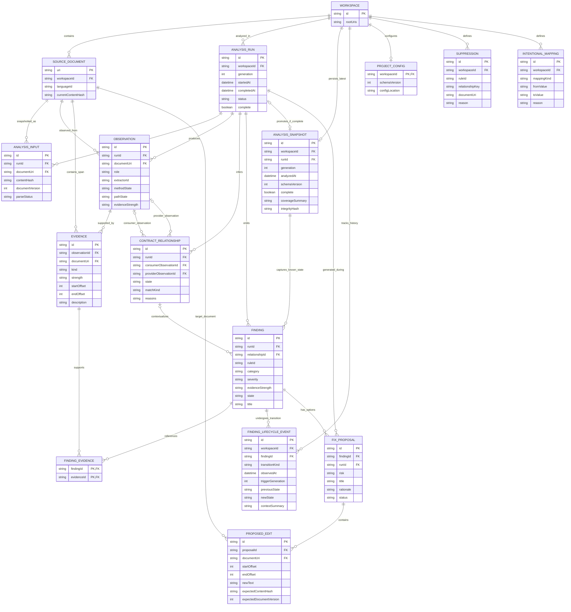

# UNDRIFT — Entity Relationship Diagram (ERD)

**Document:** `ERD.md`  
**Version:** 1.0-draft  
**Status:** Logical data-model design for review  
**Date:** 2026-10-15  
**Project:** UNDRIFT — local-first integration intelligence tool  
**Related documents:** `PRD.md`, `TRD.md`, `HLD.md`, `LLD.md`

---

## 1. Purpose

This document defines UNDRIFT's logical data entities and their relationships. It complements the HLD and LLD by making the relationships between workspace source, analysis runs, extracted observations, evidence, contract relationships, findings, and repair proposals explicit.

The ERD is a **logical/runtime model**, not a physical database schema.

### 1.1 Important persistence decision

The architecture does not require an external relational database, embedded database (such as SQLite), or remote persistence service. However, UNDRIFT persists the **latest complete analysis snapshot** and **finding lifecycle history** across VS Code sessions within **VS Code-managed, workspace-scoped extension storage** (`ExtensionContext.storageUri` workspace directory as the candidate for structured snapshot and history files, and `ExtensionContext.workspaceState` as a possible mechanism for lightweight workspace metadata; exact allocation is provisional pending validation).

This document establishes the logical entities and relationships governing both in-memory analysis and persisted state:
- **Current source code** remains authoritative for the workspace.
- **Analysis runs and transient AST caches** remain ephemeral working state.
- **The latest complete analysis snapshot** represents the last known analyzed state and is preserved across sessions.
- **Finding lifecycle events** track historical transitions (`detected`, `changed`, `resolved`, `reintroduced`) with observation timestamps.
- **Disposable caches** can be cleared without destroying finding history.

Storage boundaries are strictly enforced: no history in a `.undrift/` repository directory, no required SQLite dependency, no remote server or cloud database, and no mandatory Git dependency.

---

## 2. Entity Relationship Diagram

The following Mermaid ER diagram describes the core logical entities. Optionality matters: a contract relationship may have only a consumer or only a provider when one side is not found in the supported analysis scope.



### 2.1 How to read this diagram

- **Workspace and source documents** define the local scope of analysis.
- **Analysis runs and inputs** record which snapshot of each document was considered for a particular generation.
- **Observations** are extracted facts about frontend consumers, backend providers, or other supported source constructs. They are not, by themselves, proof of a match.
- **Evidence** records provenance and source spans supporting observations.
- **Contract relationships** connect a consumer observation to a provider observation when possible. One side may be absent for a missing-provider or no-known-consumer result.
- **Findings** describe a rule result for an analysis generation, optionally contextualized by a contract relationship.
- **Finding evidence** links a finding to the concrete evidence relevant to it.
- **Fix proposals and proposed edits** represent suggested changes. A proposal may contain no automatic edits if manual resolution or a target choice is required.
- **Project configuration, suppressions, and intentional mappings** represent user-authored configuration, not derived analysis truth.

---

## 3. Entity Definitions and Responsibilities

### 3.1 WORKSPACE

Represents the workspace or workspace session being analyzed.

**Key attributes**
- `id`: stable identifier for the current logical workspace/session.
- `rootUris`: one or more root URIs, depending on how multi-root workspaces are supported.

**Relationships**
- Contains source documents in scope.
- Has zero or more analysis runs.
- Persists zero or one latest complete analysis snapshot (`ANALYSIS_SNAPSHOT`) in VS Code workspace storage.
- Owns zero or more historical finding lifecycle events (`FINDING_LIFECYCLE_EVENT`) in VS Code workspace storage.
- May have one effective project configuration.
- May define suppressions and intentional mappings.

**Notes**
A workspace entity does not imply a hosted account or remote registry. It is partitioned locally within VS Code-managed, workspace-scoped storage.

### 3.2 SOURCE_DOCUMENT

Represents a source/configuration document discoverable in the workspace.

**Key attributes**
- `uri`: document identity within the workspace.
- `workspaceId`: workspace owning the document.
- `languageId`: language/file kind used to select parsers and analyzers.
- `currentContentHash`: hash of the current known content snapshot, when available.

**Relationships**
- Belongs to a workspace.
- Can appear in multiple analysis inputs across generations.
- Can produce multiple observations.
- Can contain multiple evidence spans and proposed edit targets.

**Notes**
The canonical in-memory `SourceDocument` also carries source text, editor document version, and dirty-buffer state. Current source code is authoritative; historical snapshots point to source locations at the time of analysis and may become stale as the codebase evolves.

### 3.3 ANALYSIS_RUN

Represents one analysis generation over a workspace snapshot.

**Key attributes**
- `id`: unique run identifier.
- `workspaceId`: workspace analyzed.
- `generation`: monotonically increasing generation/revision identifier within a workspace session.
- `startedAt` / `completedAt`: lifecycle timestamps.
- `status`: queued, running, completed, cancelled, failed, or an equivalent state.
- `complete`: whether the run has sufficient coverage to treat absence findings as meaningful within its scope.

**Relationships**
- Belongs to one workspace.
- Includes document snapshots through `ANALYSIS_INPUT`.
- Produces observations, relationships, findings, and proposals.
- Promotes to `ANALYSIS_SNAPSHOT` if and only if `status == "completed"` and `complete == true` with sufficient coverage.

**Notes**
Incomplete, cancelled, or failed runs do NOT promote to snapshots and do NOT overwrite the persisted `ANALYSIS_SNAPSHOT`.

### 3.4 ANALYSIS_INPUT

Represents a document snapshot participating in an analysis run.

**Key attributes**
- `id`: identity of this run/document input.
- `runId`: analysis generation.
- `documentUri`: source document included.
- `contentHash`: hash of the exact text snapshot analyzed.
- `documentVersion`: VS Code version where applicable.
- `parseStatus`: parsed, partial, failed, skipped, or another explicit state.

**Why this entity exists**
A source document can change between analysis runs. The model must preserve which version was parsed so stale analysis, diagnostics, or fixes cannot be mistaken for current results.

**Constraint**
Within one run, a document URI should map to one exact input snapshot. If the document changes during analysis, the old run is stale or superseded; a new generation must be scheduled.

### 3.5 OBSERVATION

Represents a fact extracted from source code.

**Examples**
- A frontend call that may invoke `GET /api/users`.
- An Express route registered for `POST /api/users`.
- A directly visible response object.
- A supported request or response type declaration.

**Key attributes**
- `id`: stable, source-derived identity when practical.
- `runId`: analysis generation producing the observation.
- `documentUri`: primary source document.
- `role`: consumer, provider, or a future supported observation role.
- `extractorId`: analyzer/extractor that produced the fact.
- `methodState` and `pathState`: known, dynamic, or unknown state, with values carried by the full domain model.
- `evidenceStrength`: qualitative evidence class.

**Relationships**
- Belongs to one analysis run.
- Originates from a source document.
- Has one or more evidence records when source-supported.
- May be referenced as the consumer or provider side of one or more candidate relationships.

**Notes**
The compact attributes in the diagram are not the full endpoint or type representation. The canonical domain model stores normalized route segments, request/response shapes, source ranges, limitations, and provenance. Do not store parser nodes inside observations.

### 3.6 EVIDENCE

Represents a source-backed reason supporting an observation.

**Key attributes**
- `id`: evidence identity.
- `observationId`: observation supported.
- `documentUri`: document containing the span.
- `kind`: literal syntax, explicit annotation, local/imported declaration, framework convention, project configuration, semantic adapter, or heuristic.
- `strength`: direct, resolved, inferred, or unknown.
- `startOffset` / `endOffset`: source range for the exact snapshot.
- `description`: optional human-readable description.

**Relationships**
- Supports one observation.
- Can be referenced by multiple findings through `FINDING_EVIDENCE`.

**Notes**
Offsets must be tied to the content hash/document version for which they were produced. The runtime implementation also carries line/character positions or uses a verified position mapper.

### 3.7 CONTRACT_RELATIONSHIP

Represents UNDRIFT's candidate or confirmed relationship between a consumer and provider observation.

**Key attributes**
- `id`: stable identity based on the involved observations and match kind.
- `runId`: analysis generation that inferred it.
- `consumerObservationId`: optional reference to a consumer.
- `providerObservationId`: optional reference to a provider.
- `state`: discovered, waiting, matched, verified, drifted, orphaned, unresolved, or ignored.
- `matchKind`: exact, method conflict, suspected route conflict, ambiguous, or unmatched.
- `reasons`: structured or serializable reasons for the candidate decision.

**Cardinality**
- A relationship refers to zero or one consumer and zero or one provider.
- At least one side must be present.
- A relationship belongs to exactly one analysis run.
- An observation can participate in zero or more candidate relationships if the matching stage finds multiple possible counterparts.

**Notes**
A relationship with a consumer but no provider can support a “no compatible provider found in the analyzed scope” finding. A provider with no known consumer is represented with the provider populated and consumer absent. Neither means the missing side is absent from the whole world. Ambiguous candidates must not be promoted to an exact relationship.

### 3.8 FINDING

Represents a rule result surfaced to the developer.

**Key attributes**
- `id`: stable identity for an unchanged issue where practical (derived from rule, endpoint, property).
- `runId`: analysis generation that emitted it.
- `relationshipId`: optional relationship being described.
- `ruleId`: stable rule identifier such as `UND120`.
- `category`, `severity`, `evidenceStrength`, and `state`.
- `title` and explanation data.

**Relationships**
- Belongs to one analysis run.
- Captured in `ANALYSIS_SNAPSHOT` when part of a completed analysis.
- Correlated across analyses via stable ID to produce `FINDING_LIFECYCLE_EVENT` records.
- May refer to one contract relationship.
- References multiple evidence records through `FINDING_EVIDENCE`.
- May have zero or more fix proposals.

**Notes**
Analysis-limit warnings can create findings without a contract relationship. Absence of a finding in an incomplete run must not be treated as proof that the issue has been resolved.

### 3.9 FINDING_EVIDENCE

A junction entity representing the many-to-many relationship between findings and evidence.

**Key attributes**
- `findingId`
- `evidenceId`

**Purpose**
A finding can be supported by evidence from both frontend and backend source, and the same source evidence may support more than one finding. The join prevents the model from copying and drifting duplicate evidence records into each finding.

### 3.10 FIX_PROPOSAL

Represents one candidate repair for a finding.

**Key attributes**
- `id`: proposal identity, normally scoped to a finding and analysis generation.
- `findingId`: issue addressed.
- `runId`: analysis generation in which the proposal was generated.
- `risk`: mechanical, review-required, or manual.
- `title` and `rationale`.
- `status`: proposed, accepted, rejected, stale, applied, or verified, as appropriate to the implementation lifecycle.

**Relationships**
- Belongs to one finding and one originating analysis generation.
- Contains zero or more proposed edits.

**Notes**
A manual proposal may have no edits. A mechanical proposal still requires explicit user acceptance. The core produces proposals but does not edit source.

### 3.11 PROPOSED_EDIT

Represents a proposed text edit to one source document.

**Key attributes**
- `id`: edit identity within the proposal.
- `proposalId`: proposal containing this edit.
- `documentUri`: target source document.
- `startOffset` / `endOffset`: UTF-16 source offsets in the expected snapshot.
- `newText`: replacement text.
- `expectedContentHash` / `expectedDocumentVersion`: staleness check.

**Relationships**
- Belongs to one proposal.
- Targets one source document.

**Notes**
The VS Code adapter revalidates the document snapshot and range immediately before constructing a `WorkspaceEdit`. Stale edits must be rejected and regenerated rather than applied to changed source.

### 3.12 PROJECT_CONFIG

Represents the effective user-authored project configuration.

**Potential content**
- Include/exclude patterns.
- Enabled analyzers and rules.
- Rule severity overrides.
- Intentional mappings.
- Suppression references or embedded suppression configuration.
- History retention settings (configurable duration and/or event count).

**Relationship**
A workspace has zero or one effective configuration document for the current initial design. VS Code user settings may override some behavior, but their final precedence belongs in the configuration design.

**Persistence**
This entity is optional in V0. It can be represented by defaults and VS Code settings initially. If persisted, it should be a versioned local/repository configuration file, not a database record by default.

### 3.13 SUPPRESSION

Represents an intentional decision not to surface a matching rule/finding under a defined scope.

**Attributes**
- `id`;
- `workspaceId`;
- `ruleId`;
- optional relationship key and/or source URI;
- reason.

**Rules**
A suppression should be narrow enough not to hide unrelated problems. It should not delete the underlying evidence. When a finding is suppressed, the report may keep it visible as suppressed rather than treating it as if the analysis never saw it.

### 3.14 INTENTIONAL_MAPPING

Represents a developer-declared transformation or relationship, such as a known field-name mapping or a route-prefix rule.

**Attributes**
- `id`;
- `workspaceId`;
- mapping kind;
- source/from value and target/to value;
- reason.

**Rules**
Mappings are explicit configuration evidence, not a blanket instruction to consider arbitrary differences compatible. They must be validated, scoped, visible in explanations, and tested. The exact supported mapping kinds should expand only alongside defined semantics and fixtures.

### 3.15 ANALYSIS_SNAPSHOT

Represents the persisted last known successfully completed analysis for the workspace.

**Key attributes**
- `id`: unique snapshot identifier.
- `workspaceId`: owning workspace.
- `runId`: reference to the originating completed `ANALYSIS_RUN`.
- `generation`: generation counter of the completed analysis.
- `analyzedAt`: timestamp when analysis completed.
- `schemaVersion`: serialization format version for forward compatibility.
- `complete`: boolean indicator (must be `true`; incomplete runs never promote to snapshots).
- `coverageSummary`: summary of files analyzed, warnings, and limitations.
- `integrityHash`: verification hash for crash/corruption detection.

**Relationships**
- Owned by one `WORKSPACE` (at most one latest snapshot per workspace).
- Promoted from one completed `ANALYSIS_RUN`.
- Captures the known states of `FINDING` entities for cross-session restoration and comparison.

**Notes**
Persisted in VS Code workspace-scoped storage. Restored upon workspace open as "last known state". Preserved intact if subsequent analyses fail or are incomplete.

### 3.16 FINDING_LIFECYCLE_EVENT

Represents a historical record of a meaningful finding lifecycle transition observed across completed analyses.

**Key attributes**
- `id`: unique event identifier.
- `workspaceId`: owning workspace.
- `findingId`: stable finding identity undergoing the transition.
- `transitionKind`: `detected`, `changed`, `resolved`, or `reintroduced`.
- `observedAt`: timestamp when the transition was observed/confirmed by analysis.
- `triggerGeneration`: analysis generation that confirmed the transition.
- `previousState`: previous finding state (`active`, `resolved`, or undefined for first detection).
- `newState`: resulting finding state.
- `contextSummary`: delta summary (e.g., previous vs. new severity, changed field shape, or resolved reason).

**Relationships**
- Owned by one `WORKSPACE`.
- References one logical `FINDING` via stable finding identity.

**Notes**
Unchanged findings generate NO new events across analyses. Historical events are pruned according to configured retention policies without destroying or degrading the `ANALYSIS_SNAPSHOT`. Observation timestamps represent analysis confirmation times, never invented source-edit times while VS Code was closed.

---

## 4. Cardinality and Integrity Rules

The ERD encodes the main relationships. The following constraints are also required even though a runtime object graph does not have database foreign-key enforcement.

1. Every `SOURCE_DOCUMENT` belongs to one workspace.
2. Every `ANALYSIS_RUN` belongs to one workspace and has a generation identifier.
3. Every `ANALYSIS_INPUT` belongs to one run and refers to one document snapshot.
4. Every `OBSERVATION` belongs to one run and has at least one primary source document/span unless the observation type explicitly represents workspace configuration.
5. Every `EVIDENCE` belongs to an observation and source span in a known snapshot.
6. Every `CONTRACT_RELATIONSHIP` belongs to one run and references at least one side (consumer or provider).
7. The role of `consumerObservationId` must be `consumer`; the role of `providerObservationId` must be `provider`.
8. Both observations in a relationship, if present, must belong to the same analysis generation.
9. Every `FINDING` belongs to one run. If it references a relationship, that relationship must be from the same run.
10. Every `FINDING_EVIDENCE` pair must reference existing finding/evidence objects; evidence should actually support the finding's explanation.
11. Every `FIX_PROPOSAL` references the finding and generation from which it was produced.
12. Every `PROPOSED_EDIT` references a proposal and a target document snapshot with expected hash/version.
13. A source change invalidates proposals that rely on changed ranges/snapshots.
14. Project configuration and suppressions do not overwrite the extracted source evidence.
15. A relationship in `verified` state must be backed by a completed current analysis for the relevant supported checks.
16. A no-known-consumer label must always retain the analyzed-scope limitation.
17. Only an `ANALYSIS_RUN` with `complete == true` and sufficient coverage can be promoted to or overwrite the workspace's `ANALYSIS_SNAPSHOT`. Incomplete, interrupted, cancelled, or failed runs must preserve the previous snapshot intact.
18. Findings in `ANALYSIS_SNAPSHOT` correspond to findings across runs via stable finding identity.
19. A finding absent from a new run can only emit a `resolved` event if the analysis run has verified sufficient coverage (`complete == true`).
20. Retention policy prunes `FINDING_LIFECYCLE_EVENT` records independently of `ANALYSIS_SNAPSHOT`; pruning must never delete or degrade the current snapshot.
21. `observedAt` timestamps in `FINDING_LIFECYCLE_EVENT` represent the timestamp when UNDRIFT observed/confirmed the transition, never an invented source-edit time.
22. Persistence writes of `ANALYSIS_SNAPSHOT` and `FINDING_LIFECYCLE_EVENT` to VS Code workspace storage must be crash-safe and recoverable to prevent inconsistent or partial records.

For the in-memory model, these constraints are enforced in domain constructors, state reconciliation logic, and test assertions.

---

## 5. ERD versus the Core Domain Model

The ERD is a relational view of logical concepts. It does not require the runtime TypeScript interfaces to be implemented as database rows.

| ERD concept | Runtime representation |
|---|---|
| `WORKSPACE` | Workspace identity/root set held by the extension/coordinator |
| `SOURCE_DOCUMENT` | `SourceDocument` snapshot, generally supplied by VS Code |
| `ANALYSIS_RUN` | `AnalysisRequest` / `AnalysisResult` generation |
| `ANALYSIS_SNAPSHOT` | `AnalysisSnapshot` persisted in VS Code workspace storage |
| `FINDING_LIFECYCLE_EVENT` | `FindingLifecycleEvent` in persisted lifecycle history |
| `ANALYSIS_INPUT` | Snapshot metadata and parse-state accounting |
| `OBSERVATION` | `ApiObservation` and other normalized facts |
| `EVIDENCE` | `EvidenceRef` plus source span/provenance |
| `CONTRACT_RELATIONSHIP` | `ContractRelationship` |
| `FINDING` | `Finding` (and `PersistedFindingRecord` in snapshot) |
| `FINDING_EVIDENCE` | Evidence references attached to finding explanations |
| `FIX_PROPOSAL` | `FixProposal` |
| `PROPOSED_EDIT` | Version/hash-bound edit intent |
| `PROJECT_CONFIG` | Resolved config plus optional config file |
| `SUPPRESSION` | A user-authored suppression entry |
| `INTENTIONAL_MAPPING` | A user-authored mapping entry |

The runtime can choose composite maps, arrays, or indexed collections for efficiency. The logical cardinality remains consistent.

---

## 6. Lifecycle and State Model

### 6.1 Analysis lifecycle

```text
CREATED
  ↓
RUNNING
  ├── COMPLETED (complete = true) ──► Reconciled & promoted to ANALYSIS_SNAPSHOT
  ├── COMPLETED (complete = false; coverage limits) ──► Preserves previous snapshot intact
  ├── CANCELLED / SUPERSEDED ──► Preserves previous snapshot intact
  └── FAILED ──► Preserves previous snapshot intact
```

The `complete` flag describes the completeness of supported analysis within the requested scope. Incomplete runs never overwrite snapshots or emit false resolution events.

### 6.2 Relationship lifecycle

```text
DISCOVERED
   ↓
WAITING / MATCHED / UNRESOLVED
   ↓
VERIFIED or DRIFTED
   ↓
IGNORED (if configured)
```

`ORPHANED` denotes a provider with no known consumer in scope; it is not a claim about external clients. A missing provider can also be represented by a waiting/unresolved relationship or rule finding, depending on the final status/UI mapping.

### 6.3 Finding lifecycle and history transitions

```text
             [First observed in completed run]
                            │
                            ▼
                        DETECTED (active)
                         │      │
       [Absent from a    │      │ [Material change
       subsequent        │      │  in finding nature]
       complete run]     │      │
                         ▼      ▼
                     RESOLVED  CHANGED (active)
                         │
        [Observed again  │
        after resolution]│
                         ▼
                    REINTRODUCED (active)
```

1. **Detected:** Finding observed for the first time in a completed analysis.
2. **Changed:** An existing finding materially changes between completed analyses.
3. **Resolved:** A previously known finding is absent from a sufficiently complete subsequent analysis of relevant scope.
4. **Reintroduced:** A previously resolved finding is detected again.
5. **Unchanged:** Findings that remain materially identical produce **no new lifecycle events**.

A finding is not resolved merely because a fix proposal was generated, accepted, or applied. Resolution comes from fresh analysis evidence.

### 6.4 Fix proposal lifecycle

```text
PROPOSED
 ├── REJECTED
 ├── STALE
 └── ACCEPTED
       ↓
     APPLIED
       ↓
     VERIFIED / STILL_ACTIVE / UNRESOLVED
```

If post-edit analysis is incomplete, the outcome should be `UNRESOLVED` or equivalent—not `VERIFIED`.

### 6.5 Session restoration and snapshot reconciliation lifecycle

```text
VS Code Workspace Opened
          │
          ▼
Restore latest complete ANALYSIS_SNAPSHOT & FINDING_LIFECYCLE_EVENT log
          │
          ├── Data exists ──► Expose as "last known state" in UI
          └── No history ───► Clean first-time workspace baseline
          │
          ▼
Trigger fresh analysis against current workspace source
          │
          ▼
Evaluate coverage & completion
          │
          ├── Incomplete / Failed ──► Retain previous ANALYSIS_SNAPSHOT;
          │                           suppress resolution / reintroduction events
          │
          └── Complete Run ─────────► Reconcile findings via stable FindingId:
                                       - derive detected, changed, resolved, reintroduced
                                       - filter unchanged findings
                                       - crash-safe write of updated snapshot & events
                                       - prune history per retention policy
                                       - update presentation to "freshly verified"
```

---

## 7. Persistence and Storage Architecture

UNDRIFT avoids requiring an external or embedded database (such as SQLite), remote server, cloud storage, or telemetry pipeline. Persistence is implemented using **VS Code-managed, workspace-scoped extension storage**: the workspace storage directory (`ExtensionContext.storageUri`) is evaluated as the candidate location for structured snapshot and finding lifecycle history files, while `ExtensionContext.workspaceState` (VS Code-managed workspace-scoped key-value persistence) is a possible mechanism for lightweight workspace metadata. The exact division of responsibilities remains provisional pending validation in POC-F. If both mechanisms are utilized, duplicated metadata in `workspaceState` must never become an independent source of truth and must remain fully recoverable or reconcilable from primary persistent records.

### 7.1 Multi-tier state separation

The logical model strictly enforces five distinct tiers:
1. **Current Source Code:** Authoritative for current code state.
2. **In-Memory Working State:** Transient parse trees and active editor buffers.
3. **Disposable Analysis Caches:** Ephemeral caches (ASTs, extractor outputs); safely discardable without losing history.
4. **Latest Complete Analysis Snapshot (`ANALYSIS_SNAPSHOT`):** Persisted last known analyzed state; restored on session open; never overwritten by incomplete runs.
5. **Finding Lifecycle History (`FINDING_LIFECYCLE_EVENT`):** Persisted transition log; pruned independently of the snapshot.

### 7.2 Storage mechanics and integrity

- **Crash-Safe and Recoverable Persistence:** Updates to the snapshot and lifecycle history require crash-safe and recoverable persistence so interrupted writes never leave partial or contradictory states. While writing to a temporary file followed by rename is a candidate strategy for `storageUri` alongside atomic key updates in `workspaceState`, universal rename atomicity is not assumed across all supported extension-host filesystem environments and will be validated in POC-F.
- **Schema Versioning:** Entities include integer schema versions. Incompatible or corrupted storage is quarantined safely, resetting to a clean baseline without fabricating history.
- **Workspace Isolation:** Data is strictly isolated by workspace identity. Findings cannot leak across unrelated projects.
- **Retention Pruning:** Expired lifecycle events are pruned according to user configuration. Pruning **never deletes or degrades the `ANALYSIS_SNAPSHOT`**.
- **Storage Boundaries:** No history is stored in the project repository (`.undrift/`), no database is required, and Git is not a mandatory dependency.

---

## 8. Open Decisions

These remain open until justified by implementation evidence:

1. **Storage API Allocation and Division of Responsibilities:** Exact division of responsibilities between `ExtensionContext.storageUri` (candidate for structured snapshot/history files) and `ExtensionContext.workspaceState` (candidate for lightweight workspace metadata/indexing), validation of write crash-safety across filesystem environments, and low-level JSON serialization format (provisional in design; validated in POC-F).
2. **Retention Settings Schema and Limits:** Specific retention duration (days), maximum event counts per workspace, and user-facing configuration schema.
3. **Stable Finding Identity Formula:** Exact canonical serialization format and cryptographic hashing function.
4. **Material Change Thresholds:** Exact quantitative or qualitative criteria defining when a finding delta triggers `changed` versus remaining unchanged.
5. **Multi-Root and Ambiguous Workspace Storage Partitioning:** File and directory mapping when no workspace root folder is formally saved (or in multi-root workspaces).
6. Whether `AnalysisRun` and `AnalysisInput` require standalone IDs in runtime memory or can be represented by generation metadata.
7. Whether future cached/historical data merits an embedded database (excluded from current scope).

---

## 9. Review Checklist

Before approving this ERD, verify that it:

- [ ] models the entities referenced by the current LLD and HLD;
- [ ] incorporates `ANALYSIS_SNAPSHOT` and `FINDING_LIFECYCLE_EVENT` in VS Code workspace storage;
- [ ] distinguishes source documents from versioned analysis inputs and persisted snapshots;
- [ ] separates extracted observations from inferred relationships and findings;
- [ ] preserves evidence and source spans without replicating entire source files;
- [ ] permits missing consumer/provider sides without claiming global absence;
- [ ] models finding lifecycle transitions (`detected`, `changed`, `resolved`, `reintroduced`);
- [ ] ensures incomplete or failed analyses do not overwrite valid snapshots or emit false resolutions;
- [ ] binds proposed edits to a source snapshot and requires re-analysis for resolution;
- [ ] treats configuration as user-authored input rather than analysis output;
- [ ] does not mandate SQLite, a remote database, or an external persistence service;
- [ ] enforces workspace isolation and crash-safe storage writes.

---

## 10. Definition

UNDRIFT's ERD defines the conceptual data relationships used by its analysis and persistence workflow:

**Workspace → Source snapshot → Observation → Evidence → Contract relationship → Finding → Fix proposal → Proposed edit → Re-analysis outcome → Analysis snapshot → Finding lifecycle events.**

Configuration, suppressions, and intentional mappings remain distinct user-authored inputs. Current source code is authoritative; the persisted snapshot records the last known analyzed state; and lifecycle events record what UNDRIFT observed across completed analyses. This preserves the local-first product direction while providing an explicit, robust data model for cross-session state reconciliation.

---

## 11. References

- `PRD.md` — product requirements and scope
- `TRD.md` — stack, constraints, and technology decisions
- `HLD.md` — component architecture and runtime flow
- `LLD.md` — domain interfaces, matching rules, fix lifecycle, and tests
- Mermaid ER diagram syntax: https://mermaid.js.org/syntax/entityRelationshipDiagram.html

---

**End of ERD — Version 1.0-draft**
