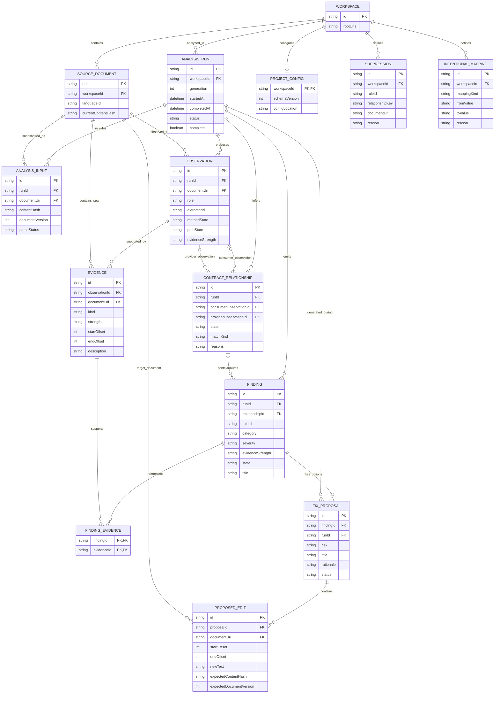

# UNDRIFT — Entity Relationship Diagram (ERD)

**Document:** `ERD.md`  
**Version:** 1.0-draft  
**Status:** Logical data-model design for review  
**Date:** 2026-10-15  
**Project:** UNDRIFT — local-first integration intelligence tool  
**Related documents:** `PRD.md`, `TRD.md`, `HLD.md`, `LLD.md`

---

## 1. Purpose

This document defines UNDRIFT's logical data entities and their relationships. It complements the HLD and LLD by making the relationships between workspace source, analysis runs, extracted observations, evidence, contract relationships, findings, and repair proposals explicit.

The ERD is a **logical/runtime model**, not a physical database schema.

### 1.1 Important persistence decision

The current TRD specifies that V0/V1 do not require a database. Analysis state can live in memory and be rebuilt from source. The entities in this ERD describe the information UNDRIFT needs to model during analysis, regardless of whether that information is held in memory or serialized for testing/reporting.

Only user-authored project settings—such as intentional mappings or suppressions—may need persistent configuration files in the first release. Do not introduce a database merely because an ERD exists.

If future product requirements justify persistent analysis history, cross-session caches, team workflows, or cross-repository data, this logical ERD can inform a later physical storage design. That future schema may need additional lifecycle, retention, indexing, and migration decisions.

---

## 2. Entity Relationship Diagram

The following Mermaid ER diagram describes the core logical entities. Optionality matters: a contract relationship may have only a consumer or only a provider when one side is not found in the supported analysis scope.



### 2.1 How to read this diagram

- **Workspace and source documents** define the local scope of analysis.
- **Analysis runs and inputs** record which snapshot of each document was considered for a particular generation.
- **Observations** are extracted facts about frontend consumers, backend providers, or other supported source constructs. They are not, by themselves, proof of a match.
- **Evidence** records provenance and source spans supporting observations.
- **Contract relationships** connect a consumer observation to a provider observation when possible. One side may be absent for a missing-provider or no-known-consumer result.
- **Findings** describe a rule result for an analysis generation, optionally contextualized by a contract relationship.
- **Finding evidence** links a finding to the concrete evidence relevant to it.
- **Fix proposals and proposed edits** represent suggested changes. A proposal may contain no automatic edits if manual resolution or a target choice is required.
- **Project configuration, suppressions, and intentional mappings** represent user-authored configuration, not derived analysis truth.

---

## 3. Entity Definitions and Responsibilities

### 3.1 WORKSPACE

Represents the workspace or workspace session being analyzed.

**Key attributes**
- `id`: stable identifier for the current logical workspace/session.
- `rootUris`: one or more root URIs, depending on how multi-root workspaces are supported.

**Relationships**
- Contains source documents in scope.
- Has zero or more analysis runs.
- May have one effective project configuration.
- May define suppressions and intentional mappings.

**Notes**
A workspace entity does not imply a hosted account or persistent workspace registry. In V0 it may be an in-memory object associated with the currently opened VS Code workspace.

### 3.2 SOURCE_DOCUMENT

Represents a source/configuration document discoverable in the workspace.

**Key attributes**
- `uri`: document identity within the workspace.
- `workspaceId`: workspace owning the document.
- `languageId`: language/file kind used to select parsers and analyzers.
- `currentContentHash`: hash of the current known content snapshot, when available.

**Relationships**
- Belongs to a workspace.
- Can appear in multiple analysis inputs across generations.
- Can produce multiple observations.
- Can contain multiple evidence spans and proposed edit targets.

**Notes**
The canonical in-memory `SourceDocument` also carries source text, editor document version, and dirty-buffer state. Those high-volume/runtime fields do not have to be persisted in any future database schema.

### 3.3 ANALYSIS_RUN

Represents one analysis generation over a workspace snapshot.

**Key attributes**
- `id`: unique run identifier.
- `workspaceId`: workspace analyzed.
- `generation`: monotonically increasing generation/revision identifier within a workspace session.
- `startedAt` / `completedAt`: lifecycle timestamps.
- `status`: queued, running, completed, cancelled, failed, or an equivalent state.
- `complete`: whether the run has sufficient coverage to treat absence findings as meaningful within its scope.

**Relationships**
- Belongs to one workspace.
- Includes document snapshots through `ANALYSIS_INPUT`.
- Produces observations, relationships, findings, and proposals.

**Notes**
In V0, the run may exist only in memory. The generation check prevents stale results from replacing results for more recent source changes. A run can finish without being complete if relevant files or analyzers failed.

### 3.4 ANALYSIS_INPUT

Represents a document snapshot participating in an analysis run.

**Key attributes**
- `id`: identity of this run/document input.
- `runId`: analysis generation.
- `documentUri`: source document included.
- `contentHash`: hash of the exact text snapshot analyzed.
- `documentVersion`: VS Code version where applicable.
- `parseStatus`: parsed, partial, failed, skipped, or another explicit state.

**Why this entity exists**
A source document can change between analysis runs. The model must preserve which version was parsed so stale analysis, diagnostics, or fixes cannot be mistaken for current results.

**Constraint**
Within one run, a document URI should map to one exact input snapshot. If the document changes during analysis, the old run is stale or superseded; a new generation must be scheduled.

### 3.5 OBSERVATION

Represents a fact extracted from source code.

**Examples**
- A frontend call that may invoke `GET /api/users`.
- An Express route registered for `POST /api/users`.
- A directly visible response object.
- A supported request or response type declaration.

**Key attributes**
- `id`: stable, source-derived identity when practical.
- `runId`: analysis generation producing the observation.
- `documentUri`: primary source document.
- `role`: consumer, provider, or a future supported observation role.
- `extractorId`: analyzer/extractor that produced the fact.
- `methodState` and `pathState`: known, dynamic, or unknown state, with values carried by the full domain model.
- `evidenceStrength`: qualitative evidence class.

**Relationships**
- Belongs to one analysis run.
- Originates from a source document.
- Has one or more evidence records when source-supported.
- May be referenced as the consumer or provider side of one or more candidate relationships.

**Notes**
The compact attributes in the diagram are not the full endpoint or type representation. The canonical domain model stores normalized route segments, request/response shapes, source ranges, limitations, and provenance. Do not store parser nodes inside observations.

### 3.6 EVIDENCE

Represents a source-backed reason supporting an observation.

**Key attributes**
- `id`: evidence identity.
- `observationId`: observation supported.
- `documentUri`: document containing the span.
- `kind`: literal syntax, explicit annotation, local/imported declaration, framework convention, project configuration, semantic adapter, or heuristic.
- `strength`: direct, resolved, inferred, or unknown.
- `startOffset` / `endOffset`: source range for the exact snapshot.
- `description`: optional human-readable description.

**Relationships**
- Supports one observation.
- Can be referenced by multiple findings through `FINDING_EVIDENCE`.

**Notes**
Offsets must be tied to the content hash/document version for which they were produced. The runtime implementation also carries line/character positions or uses a verified position mapper.

### 3.7 CONTRACT_RELATIONSHIP

Represents UNDRIFT's candidate or confirmed relationship between a consumer and provider observation.

**Key attributes**
- `id`: stable identity based on the involved observations and match kind.
- `runId`: analysis generation that inferred it.
- `consumerObservationId`: optional reference to a consumer.
- `providerObservationId`: optional reference to a provider.
- `state`: discovered, waiting, matched, verified, drifted, orphaned, unresolved, or ignored.
- `matchKind`: exact, method conflict, suspected route conflict, ambiguous, or unmatched.
- `reasons`: structured or serializable reasons for the candidate decision.

**Cardinality**
- A relationship refers to zero or one consumer and zero or one provider.
- At least one side must be present.
- A relationship belongs to exactly one analysis run.
- An observation can participate in zero or more candidate relationships if the matching stage finds multiple possible counterparts.

**Notes**
A relationship with a consumer but no provider can support a “no compatible provider found in the analyzed scope” finding. A provider with no known consumer is represented with the provider populated and consumer absent. Neither means the missing side is absent from the whole world. Ambiguous candidates must not be promoted to an exact relationship.

### 3.8 FINDING

Represents a rule result surfaced to the developer.

**Key attributes**
- `id`: stable identity for an unchanged issue where practical.
- `runId`: analysis generation that emitted it.
- `relationshipId`: optional relationship being described.
- `ruleId`: stable rule identifier such as `UND120`.
- `category`, `severity`, `evidenceStrength`, and `state`.
- `title` and explanation data.

**Relationships**
- Belongs to one analysis run.
- May refer to one contract relationship.
- References multiple evidence records through `FINDING_EVIDENCE`.
- May have zero or more fix proposals.

**Notes**
Analysis-limit warnings can create findings without a contract relationship. Absence of a finding in an incomplete run must not be treated as proof that the issue has been resolved.

### 3.9 FINDING_EVIDENCE

A junction entity representing the many-to-many relationship between findings and evidence.

**Key attributes**
- `findingId`
- `evidenceId`

**Purpose**
A finding can be supported by evidence from both frontend and backend source, and the same source evidence may support more than one finding. The join prevents the model from copying and drifting duplicate evidence records into each finding.

### 3.10 FIX_PROPOSAL

Represents one candidate repair for a finding.

**Key attributes**
- `id`: proposal identity, normally scoped to a finding and analysis generation.
- `findingId`: issue addressed.
- `runId`: analysis generation in which the proposal was generated.
- `risk`: mechanical, review-required, or manual.
- `title` and `rationale`.
- `status`: proposed, accepted, rejected, stale, applied, or verified, as appropriate to the implementation lifecycle.

**Relationships**
- Belongs to one finding and one originating analysis generation.
- Contains zero or more proposed edits.

**Notes**
A manual proposal may have no edits. A mechanical proposal still requires explicit user acceptance. The core produces proposals but does not edit source.

### 3.11 PROPOSED_EDIT

Represents a proposed text edit to one source document.

**Key attributes**
- `id`: edit identity within the proposal.
- `proposalId`: proposal containing this edit.
- `documentUri`: target source document.
- `startOffset` / `endOffset`: UTF-16 source offsets in the expected snapshot.
- `newText`: replacement text.
- `expectedContentHash` / `expectedDocumentVersion`: staleness check.

**Relationships**
- Belongs to one proposal.
- Targets one source document.

**Notes**
The VS Code adapter revalidates the document snapshot and range immediately before constructing a `WorkspaceEdit`. Stale edits must be rejected and regenerated rather than applied to changed source.

### 3.12 PROJECT_CONFIG

Represents the effective user-authored project configuration.

**Potential content**
- Include/exclude patterns.
- Enabled analyzers and rules.
- Rule severity overrides.
- Intentional mappings.
- Suppression references or embedded suppression configuration.

**Relationship**
A workspace has zero or one effective configuration document for the current initial design. VS Code user settings may override some behavior, but their final precedence belongs in the configuration design.

**Persistence**
This entity is optional in V0. It can be represented by defaults and VS Code settings initially. If persisted, it should be a versioned local/repository configuration file, not a database record by default.

### 3.13 SUPPRESSION

Represents an intentional decision not to surface a matching rule/finding under a defined scope.

**Attributes**
- `id`;
- `workspaceId`;
- `ruleId`;
- optional relationship key and/or source URI;
- reason.

**Rules**
A suppression should be narrow enough not to hide unrelated problems. It should not delete the underlying evidence. When a finding is suppressed, the report may keep it visible as suppressed rather than treating it as if the analysis never saw it.

### 3.14 INTENTIONAL_MAPPING

Represents a developer-declared transformation or relationship, such as a known field-name mapping or a route-prefix rule.

**Attributes**
- `id`;
- `workspaceId`;
- mapping kind;
- source/from value and target/to value;
- reason.

**Rules**
Mappings are explicit configuration evidence, not a blanket instruction to consider arbitrary differences compatible. They must be validated, scoped, visible in explanations, and tested. The exact supported mapping kinds should expand only alongside defined semantics and fixtures.

---

## 4. Cardinality and Integrity Rules

The ERD encodes the main relationships. The following constraints are also required even though a runtime object graph does not have database foreign-key enforcement.

1. Every `SOURCE_DOCUMENT` belongs to one workspace.
2. Every `ANALYSIS_RUN` belongs to one workspace and has a generation identifier.
3. Every `ANALYSIS_INPUT` belongs to one run and refers to one document snapshot.
4. Every `OBSERVATION` belongs to one run and has at least one primary source document/span unless the observation type explicitly represents workspace configuration.
5. Every `EVIDENCE` belongs to an observation and source span in a known snapshot.
6. Every `CONTRACT_RELATIONSHIP` belongs to one run and references at least one side (consumer or provider).
7. The role of `consumerObservationId` must be `consumer`; the role of `providerObservationId` must be `provider`.
8. Both observations in a relationship, if present, must belong to the same analysis generation.
9. Every `FINDING` belongs to one run. If it references a relationship, that relationship must be from the same run.
10. Every `FINDING_EVIDENCE` pair must reference existing finding/evidence objects; evidence should actually support the finding's explanation.
11. Every `FIX_PROPOSAL` references the finding and generation from which it was produced.
12. Every `PROPOSED_EDIT` references a proposal and a target document snapshot with expected hash/version.
13. A source change invalidates proposals that rely on changed ranges/snapshots.
14. Project configuration and suppressions do not overwrite the extracted source evidence.
15. A relationship in `verified` state must be backed by a completed current analysis for the relevant supported checks.
16. A no-known-consumer label must always retain the analyzed-scope limitation.

For the in-memory model, these constraints should be enforced in constructors/factories and test assertions where practical. If a persistent store is added later, equivalent constraints can be represented with foreign keys/check constraints and transaction boundaries.

---

## 5. ERD versus the Core Domain Model

The ERD is a relational view of logical concepts. It does not require the runtime TypeScript interfaces to be implemented as database rows.

| ERD concept | Runtime representation |
|---|---|
| `WORKSPACE` | Workspace identity/root set held by the extension/coordinator |
| `SOURCE_DOCUMENT` | `SourceDocument` snapshot, generally supplied by VS Code |
| `ANALYSIS_RUN` | `AnalysisRequest` / `AnalysisResult` generation |
| `ANALYSIS_INPUT` | Snapshot metadata and parse-state accounting |
| `OBSERVATION` | `ApiObservation` and other normalized facts |
| `EVIDENCE` | `EvidenceRef` plus source span/provenance |
| `CONTRACT_RELATIONSHIP` | `ContractRelationship` |
| `FINDING` | `Finding` |
| `FINDING_EVIDENCE` | Evidence references attached to finding explanations |
| `FIX_PROPOSAL` | `FixProposal` |
| `PROPOSED_EDIT` | Version/hash-bound edit intent |
| `PROJECT_CONFIG` | Resolved config plus optional config file |
| `SUPPRESSION` | A user-authored suppression entry |
| `INTENTIONAL_MAPPING` | A user-authored mapping entry |

The runtime can choose composite maps, arrays, or indexed collections for efficiency. The logical cardinality should remain consistent.

---

## 6. Lifecycle and State Model

### 6.1 Analysis lifecycle

```text
CREATED
  ↓
RUNNING
  ├── COMPLETED (complete = true)
  ├── COMPLETED (complete = false; warnings/coverage limits)
  ├── CANCELLED / SUPERSEDED
  └── FAILED
```

The `complete` flag describes the completeness of supported analysis within the requested scope. It does not mean all languages/frameworks or all runtime behaviors were understood.

### 6.2 Relationship lifecycle

```text
DISCOVERED
   ↓
WAITING / MATCHED / UNRESOLVED
   ↓
VERIFIED or DRIFTED
   ↓
IGNORED (if configured)
```

`ORPHANED` denotes a provider with no known consumer in scope; it is not a claim about external clients. A missing provider can also be represented by a waiting/unresolved relationship or rule finding, depending on the final status/UI mapping.

### 6.3 Finding lifecycle

```text
ACTIVE
 ├── SUPPRESSED (explicit user/config choice)
 └── RESOLVED (a later complete-enough analysis confirms the issue is absent)
```

A finding is not resolved merely because a fix proposal was generated, accepted, or applied. Resolution comes from current analysis evidence.

### 6.4 Fix proposal lifecycle

```text
PROPOSED
 ├── REJECTED
 ├── STALE
 └── ACCEPTED
       ↓
     APPLIED
       ↓
     VERIFIED / STILL_ACTIVE / UNRESOLVED
```

If post-edit analysis is incomplete, the outcome should be `UNRESOLVED` or equivalent—not `VERIFIED`.

---

## 7. Persistence and Future Database Considerations

No database is required for the first product release. Do not implement SQL schema, migrations, database client setup, or hosted persistence simply to satisfy the existence of an ERD.

If later requirements justify persistence, first define the concrete use case:

- Should findings survive extension restarts?
- Is a workspace-level cache necessary after performance measurement?
- Is historical drift/change tracking useful?
- Will a team or CI workflow share state across machines?
- Does the product need multi-repository identity or permissions?

A local cache might use a versioned local index file or a small embedded database. A future hosted team product would require a separate architecture and security review. The existing ERD is a starting conceptual model, not a commitment to either storage choice.

Any future persisted schema should add:
- schema/version migration strategy;
- retention and cache invalidation rules;
- workspace/source identity strategy;
- indexes based on demonstrated query patterns;
- atomic update strategy so a partial analysis does not replace a good result;
- compatibility rules for old results generated by previous analyzer versions;
- a clear boundary between current source truth, disposable derived cache, and user-authored configuration.

---

## 8. Open Decisions

These remain open until the implementation provides evidence:

1. Whether `AnalysisRun` and `AnalysisInput` require stable standalone IDs in the V0 runtime model or can be represented by generation metadata and snapshot maps.
2. Whether evidence should be explicit objects or compact source/provenance fields inside observations/findings for first-release simplicity.
3. Exact stable-ID and hashing strategy.
4. Final persistence format and configuration filename for suppressions/mappings.
5. Whether future cached/historical data merits an embedded database.
6. How many consumers/providers a relationship may aggregate once real framework patterns are examined.
7. Whether runtime event/specification evidence will later extend the same observation model or introduce explicit source-specific evidence entities.

These choices must not introduce a database requirement into V0 by implication.

---

## 9. Review Checklist

Before approving this ERD, verify that it:

- [ ] models the entities referenced by the current LLD;
- [ ] distinguishes source documents from versioned analysis inputs;
- [ ] separates extracted observations from inferred relationships and findings;
- [ ] preserves evidence and source spans;
- [ ] permits missing consumer/provider sides without claiming global absence;
- [ ] distinguishes suppressed, unresolved, active, and resolved findings;
- [ ] keeps fix proposals separate from accepted/applied edits;
- [ ] binds proposed edits to a source snapshot;
- [ ] treats configuration as user-authored input rather than analysis output;
- [ ] does not imply a required database;
- [ ] leaves future history/team persistence as a separate decision.

---

## 10. Definition

UNDRIFT's ERD defines the conceptual data relationships used by its analysis workflow:

**Workspace → Source snapshot → Observation → Evidence → Contract relationship → Finding → Fix proposal → Proposed edit → Re-analysis outcome.**

Configuration, suppressions, and intentional mappings remain distinct user-authored inputs. The initial implementation keeps derived data in memory and re-derives the current answer from source. This preserves the local-first product direction while providing an explicit data model for implementation, testing, and possible future persistence.

---

## 11. References

- `PRD.md` — product requirements and scope
- `TRD.md` — stack, constraints, and technology decisions
- `HLD.md` — component architecture and runtime flow
- `LLD.md` — domain interfaces, matching rules, fix lifecycle, and tests
- Mermaid ER diagram syntax: https://mermaid.js.org/syntax/entityRelationshipDiagram.html

---

**End of ERD — Version 1.0-draft**
